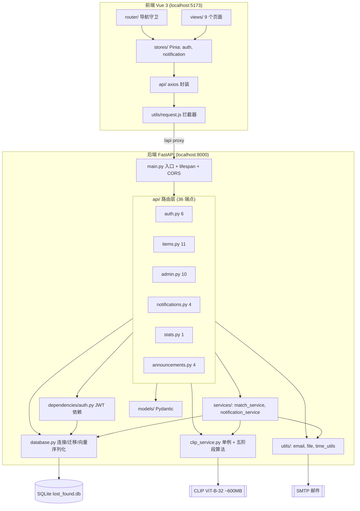
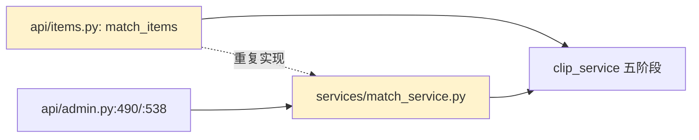
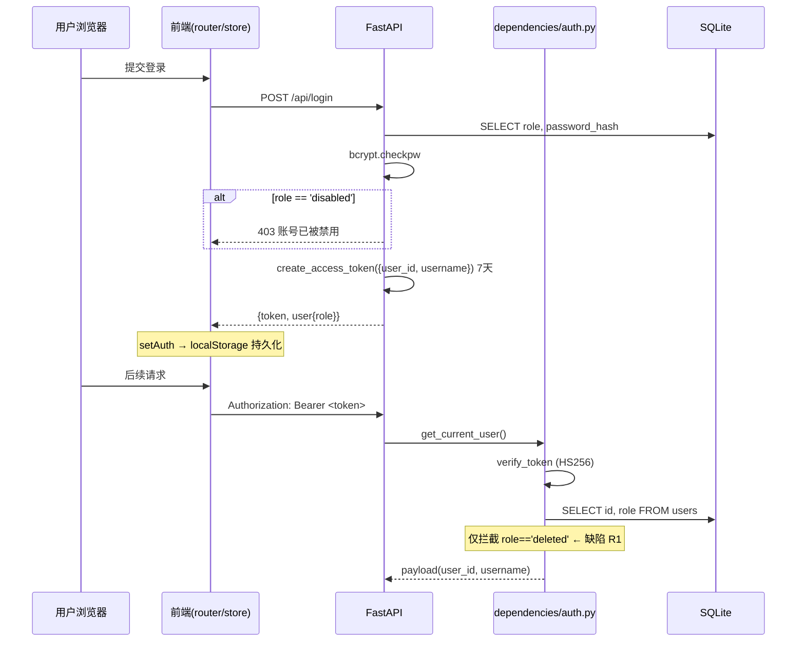
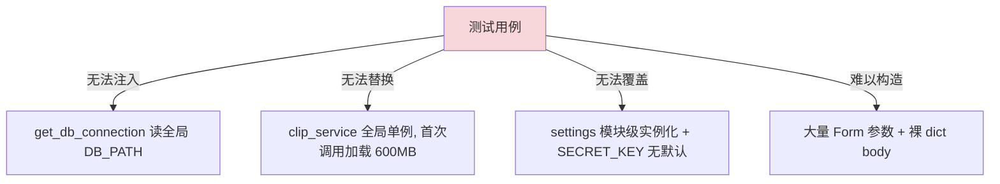

# 校园失物检索平台 v3.3.2 — 正式架构评审报告

| 项目 | 内容 |
|------|------|
| 评审对象 | 校园失物检索平台 v3.3.2（FastAPI + Vue 3 + CLIP） |
| 评审类型 | 交付前架构评审（毕设 / 实训课程交付标尺） |
| 评审人 | 架构师 高见远 |
| 评审日期 | 2026-09-12 |
| 代码基线 | `C:\Users\33834\Desktop\lost-found-v3`（后端 29 个 .py / 前端 26 个源文件 / 6 路由模块 36 端点） |
| 结论 | **架构方向正确、分层清晰、核心算法有真设计；主要风险集中在「鉴权语义漏洞 + 时区口径 + 工程规范（测试/类型/死代码）」三类，均为可控的局部修复，无需架构级改造** |

---

## 1. 评审范围与方法

### 1.1 评审方法

本次评审**以源码为准**，逐文件通读后端 `backend/app/**`（29 个 .py）与前端 `lost-found-frontend/src/**`（26 个文件），并以检索交叉验证关键结论；文档（`PROJECT.md` / `SRS.md` / `README.md` / `CHANGELOG.md`）仅作为**对照物**用于识别「文档漂移」，不作为事实来源。

| 证据来源 | 采集方式 | 用途 |
|----------|----------|------|
| 后端源码 | 全文通读 6 个路由模块 + 服务 + 依赖 + 工具 | 端点契约、事务边界、鉴权、算法 |
| 前端源码 | 通读 router / store / layout / 关键 view | 鉴权联调路径、轮询实现 |
| 依赖清单 | `requirements.txt` + `package.json` + 代码 `import` | 依赖声明与真实使用的一致性 |
| 检索验证 | 对 `passlib` / 错误格式 / 路由装饰器 / 未用模型 做交叉检索 | 死代码与不一致的举证 |
| 文档对照 | PROJECT / CHANGELOG / README 关键断言与代码比对 | 文档漂移清单 |

> 本次评审**不修改任何源代码**，修复工作由工程师独立执行。

### 1.2 评审标尺声明

本项目定位为**高校校园失物招领平台 / 毕设·实训交付级项目**，非互联网生产系统。因此：
- ✅ 采用「**课程交付质量**」标尺：关注**正确性、可演示性、可维护性、文档与代码一致**；
- ❌ **不建议**引入微服务、K8s、消息队列、服务网格、分布式缓存等与交付场景不匹配的方案；
- 对团队在 `PROJECT.md §11` 自列的「PostgreSQL/FAISS/Celery/OSS」等**远期演进路线**，评审态度为：**方向合理、但当前阶段不建议实施**，理由见 §9。

---

## 2. 架构总览与分层评估

### 2.1 组件与依赖方向



### 2.2 分层评估

| 层次 | 目录 | 职责 | 评价 |
|------|------|------|------|
| 入口/装配 | `main.py` | 生命周期、CORS、路由注册、全局异常 | ✅ 简洁；⚠️ 含死代码（§2.4） |
| 路由层 | `app/api/*` | HTTP 契约、参数校验、鉴权挂载 | ✅ 划分清晰，6 模块职责单一 |
| 依赖注入 | `dependencies/auth.py` | JWT 签发/校验/角色门禁 | ✅ 集中；⚠️ 门禁语义有洞（§3） |
| 业务服务 | `services/*` | 自动匹配、通知编排 | ✅ 有服务层意识；⚠️ 与路由层耦合（见下） |
| 算法核心 | `clip_service.py` | 特征提取 + 五阶段相似度 | ✅ 单例 + 懒加载，设计良好（§5） |
| 数据访问 | `database.py` | 连接上下文、迁移、向量序列化、通知/计数 DAO | ⚠️ 职责偏重（DDL+迁移+DAO+序列化混合） |
| 领域模型 | `models/*` | Pydantic 模型 | ❌ **大部分定义后未被引用**（§2.4） |
| 工具 | `utils/*` | 邮件、文件、时间 | ⚠️ 邮件为同步阻塞（§5.4） |

### 2.3 依赖方向与循环依赖分析

- **依赖方向总体健康**：`api → services / core / db / models / utils`，`services → core / db / utils`，方向自上而下，无反向依赖。
- **无循环依赖**：`main → api → (services, clip_service, database, dependencies)` 为单向 DAG。
- **两处「路由层直接承载业务」的耦合**（非架构缺陷，但削弱可测性）：
  1. `api/items.py:456-562 match_items()` 在路由函数内联整套匹配循环（读库 → 逐候选提色 → 计算 → 排序），与 `services/match_service.py` 的自动匹配几乎重复实现，**同一算法两处维护**；
  2. `api/admin.py` 直接 `from ..api.auth import check_unique_contact`（L366），存在**api 层横向依赖**，理想应下沉到 service。



### 2.4 死代码 / 未使用定义（已检索确认）

| 位置 | 内容 | 证据 |
|------|------|------|
| `main.py:31-39` | `LocalhostRegexOrigin` 类定义后从未使用（实际用 `allow_origin_regex`） | 类体无任何引用 |
| `config.py:23` | `CORS_ORIGINS` 定义后未生效（CORS 用硬编码 regex） | `main.py:43` 未读取该配置 |
| `database.py:160` | 仍创建 `uploads/avatars/` 目录，头像功能 V3.3 已移除 | CHANGELOG V3.3「砍掉头像上传」 |
| `models/item.py`（全文件） | `ItemCreate`/`ItemUpdate`/`ItemResponse` 定义后无引用（发布用 `Form(...)`，编辑用手工 `request.form()`） | 全局检索仅命中定义处 |
| `models/notification.py` | `NotificationResponse` 未被引用 | 同上 |
| `models/user.py:33` | `UserResponse` 未被引用 | 同上 |
| `models/common.py:7` + `api/admin.py:14` | `PagedResponse` 定义并 import，但函数体内从未使用 | 仅 import 处命中 |
| `services/notification_service.py` | `send_notification()` 未被任何路由引用 | 检索无调用 |
| `models/match.py` | `MatchResult`/`MatchResponse`/`MatchConfirm` 未使用（仅 `MatchRequest` 被 `items.py:18` 引用） | 检索命中 |

> 结论：`models/` 目录整体处于「**半成品**」状态——只有 `UserRegister`/`UserLogin`/`MatchRequest`/`ReviewAction`/`ReviewResponse` 5 个模型真正在跑。这直接导致 §6.3 的「裸 dict 请求体」问题：有类型系统的能力却未使用。

---

## 3. 鉴权与权限模型评审

### 3.1 认证链路



### 3.2 关键风险：禁用语义前后端不一致（R1 / P0）

| 环节 | 代码位置 | 实际行为 |
|------|----------|----------|
| 登录时拦截 | `api/auth.py:79` | ✅ 拦截 `role == 'disabled'` |
| **接口鉴权时** | `dependencies/auth.py:54` | ❌ **只拦截 `role == 'deleted'`，不拦截 `'disabled'`** |
| 前端守卫 | `router/index.js:77` | 检查 `authStore.user.role === 'disabled'` |
| 前端角色来源 | `stores/auth.js:38-48 restore()` | ⚠️ **只读 localStorage 旧缓存，从不向后端刷新** |

**攻击路径（已推演）**：用户 A 登录取得 7 天有效 JWT → 管理员将其禁用 → A 的 localStorage 仍缓存 `role:'user'` → 前端守卫放行 → A 用旧 JWT 调用任意后端接口 → `get_current_user` 只查 DB 里 role 是否 `deleted`（否）→ **放行**。

**影响面**：`get_current_user` / `get_current_admin` 保护的全部端点（发布、编辑、删除、认领、匹配、公告、管理端）。这是**确凿的越权缺陷**，且**无法靠前端修复**（前端缓存不可信），必须在后端补齐。

**建议方案（交付前必做，工作量小）**：
```python
# dependencies/auth.py, 替换 L54 的判断语义
if user['role'] in ('deleted', 'disabled'):
    raise HTTPException(403, "账号不可用" if user['role']=='disabled' else "账号已注销")
```
同时前端 `stores/auth.js` 增加应用启动时调用 `fetchUser()` 向后端校正一次角色（可选，后端修复后非必需）。

### 3.3 `payload.get('user_id')` 信任边界评估

- JWT 为 HS256 签名，`user_id`/`username` 的**完整性可信**（无 `SECRET_KEY` 不可伪造），**但没有把 `role` 放进 token** —— 这是**正确的**做法：`get_current_admin`（`auth.py:66-81`）每次从 DB 读 role，避免了「升级/降级后 token 内角色过期」。
- **残留风险**：`get_current_user` 只回传 `payload`（`user_id`/`username`），而 `role` 的实时性完全依赖 `auth.py:44-53` 这次 DB 查询——正是 §3.2 漏掉 `disabled` 的地方。修复语义后，该边界即闭合。
- `username` 在 token 内但不用于授权判断，安全。

### 3.4 注销（deleted）与禁用（disabled）语义混乱点

| 维度 | `deleted`（注销） | `disabled`（禁用） |
|------|-------------------|--------------------|
| 触发 | 用户自助 `DELETE /api/me`（auth.py:184）或管理员删（admin.py:379） | 管理员 `PUT /admin/users/{id}` toggle（admin.py:333） |
| 用户名 | 追加 `_deleted_<id>` 后缀 | 不变 |
| 物品 | 批量置 `closed` | **不处理**（物品仍 active） |
| 登录 | 用户名已被改名，**无法再登录** | 登录被 403 拦截 |
| 接口鉴权 | ✅ 被拦截 | ❌ **未被拦截（R1）** |
| 复用同一 `role` 字段 | 是 | 是 |

**根因**：项目用**单一 `role` 文本字段**同时表达「权限级别（user/admin）」与「账号状态（active/deleted/disabled）」两种正交语义，导致状态机重叠（例如「admin 被禁用」无法用 role 表达，`toggle_status` 会把 admin 直接改成 disabled，丢失原角色，admin.py:338）。**课程交付阶段可接受**，但建议至少加注释说明取值域；彻底做法是拆 `role` + `status` 两列（§9「可延后」）。

**其它鉴权相关核实**：
- `get_item`（`items.py:221`）/ `GET /items/`（L131）/ `/items/categories`（L203）/ `/items/uploads/{filename}`（L209）**均为公开接口**，与 `PROJECT.md §5.2` 标注「需认证 ✅」**不符**（文档漂移，见 §8-R11）。其中 `get_item` 对未审核物品返回 `404` 而非 `403`，**防信息泄露做法正确**（值得肯定）。
- 注意：公开的 `/items/` 会读取 Authorization 头解析 `viewer_id`（L143-147），但**不校验账号状态**，禁用用户的 token 仍可命中「查看自己物品」分支（次要，随 R1 一并修复）。

---

## 4. 数据层与事务模型评审

### 4.1 SQLite 连接与事务模型

| 项 | 实现 | 评价 |
|----|------|------|
| 连接封装 | `database.py:16-34 get_db_connection()` 上下文管理器：成功 `commit`、异常 `rollback` + 记日志、`finally close` | ✅ **统一事务边界，是本项目最扎实的一处设计** |
| 隔离参数 | `sqlite3.connect(DB_PATH, timeout=10)`，未设 `check_same_thread`、未开 WAL | ⚠️ 默认 journal 模式，写并发受限 |
| 参数化 | 全部使用 `?` 占位符（`items.py:114`、`admin.py:527` 等），动态拼接仅限**列名白名单**（`auth.py:177`、`admin.py:294` 的 ORDER BY） | ✅ SQL 注入面很小（拼接处均为固定字符串，非用户输入） |
| 并发写 | `get_current_user` 每次请求开连接；写操作串行受 SQLite 文件锁限制 | ⚠️ 校园级流量可接受；`PROJECT.md §11` 已如实标注「并发 >20 性能下降」 |

**并发与正确性亮点**：审核采用**条件更新 + `rowcount` 判定**——`UPDATE ... WHERE id=? AND review_status='pending'`，`rowcount==0` 返回 `409 冲突`（`admin.py:179-206`）。这是**天然的并发防重复审核**，做法正确，值得保留。

### 4.2 手工迁移（`PRAGMA table_info`）的可维护性

`init_db()`（`database.py:37-176`）内联了 **3 段**手工迁移：

| 位置 | 迁移 | 方式 |
|------|------|------|
| L111-115 | `items.reject_reason` | `PRAGMA table_info` + `ALTER TABLE ADD COLUMN` |
| L118-122 | `users.avatar_path` | 同上（**该列 V3.3 已废弃**，仍在建） |
| L152-156 | `announcements.target_role` | 同上 |

评价：对**零配置毕设**是务实选择（无 Alembic 依赖），但存在三点隐忧：
1. **迁移逻辑与建表逻辑混写**在同一函数，无版本号、无幂等记录表，长期演进会越来越难读；
2. `users.avatar_path` 迁移已无存在意义（头像功能移除），却仍在每次启动执行 `PRAGMA` 探查；
3. 无「迁移失败回滚」策略——`ALTER` 出错会导致启动失败（`init_db` 在 `lifespan` 中，`main.py:15`）。

**建议**：保留手工迁移机制（符合课程交付），但抽出一个 `migrations` 列表 + 每步打日志，并删除失效的 avatar 迁移（小改动）。

### 4.3 向量列演进路径

- 现状：`items.image_vector`/`text_vector` 为 `TEXT`，经 `vector_to_json`/`json_to_vector`（`database.py:180-198`）做 **512 维 float 列表**的 JSON 序列化/反序列化。
- 代价：JSON 文本体积大（512 维约 8–10KB/列），反序列化在匹配时对**每个候选**执行（`items.py:503-504`），CPU + 内存开销随候选数线性增长。
- **颜色向量完全没有列**（见 §5.3），是最突出的数据层缺口。
- 演进路径建议（**仅记录，当前不必做**）：
  1. 近期（课程内，可选）：新增 `items.color_vector TEXT` 列持久化 27 维颜色直方图；
  2. 中期（不做）：JSON → `BLOB`（`np.tobytes`）省 30–50% 体积；
  3. 远期（不做）：迁移 pgvector/FAISS 做 ANN——`PROJECT.md §11.2 V4.0` 已规划，但**与毕设交付不匹配**。

### 4.4 索引评估

现有 9 个索引（`database.py:162-174`）：

| 索引 | 覆盖查询 | 评估 |
|------|----------|------|
| `idx_notifications_user_read (user_id,is_read)` | 未读数 / 未读列表 | ✅ 复合索引命中 `notifications.py:10,17` |
| `idx_items_user_id` | 「我的物品」`items.py:166` | ✅ |
| `idx_items_type` | 列表 type 过滤 `items.py:171` | ✅（选择性低，但与 status 组合可用） |
| `idx_items_status` | `WHERE status='active'` | ✅ 高频 |
| `idx_items_review_status` | 审核列表 `admin.py:59` | ✅ |
| `idx_items_created_at` | `ORDER BY created_at DESC` | ✅ 列表排序 |
| `idx_users_username` | 登录/查重 | ✅（username 已 UNIQUE，索引冗余但无害） |
| `idx_matches_lost_item` / `idx_matches_found_item` | 匹配表外键 | ✅ |

**缺口**：`items` 高频组合查询为 `WHERE type=? AND status='active' AND review_status='approved'`（`items.py:496`、`match_service.py:35`），当前**无复合索引**覆盖该三列。数据量 >数千条时会有全表扫描。建议（可选）加：
```sql
CREATE INDEX IF NOT EXISTS idx_items_type_status_review ON items(type, status, review_status);
```
数据量小时（`PROJECT.md §10` 实测仅 9 条）**非必须**，但成本极低、收益确定。

---

## 5. 算法工程化评审

### 5.1 五阶段算法的可持续性

`clip_service.py:87-161 compute_weighted_similarity()` 实现了五阶段融合。**评价：这是全项目最有工程含金量的部分，设计意图明确且正确。**

| 阶段 | 实现（行号） | 评价 |
|------|--------------|------|
| 基础融合 | 图 0.50 / 文 0.30 / 色 0.20（L119-121） | ✅ 三类特征加权 |
| 动态权重归一化 | L123-134，缺维按比例重分配，`/total_w` 保证权重和为 1 | ✅✅ **有意识的设计**：纯文本匹配时权重回归 1.0，避免「缺失维度拖累整体分数够不到阈值」——这是常见坑的正解 |
| 阶段1 类别/位置调节 | L136-147 同类 +0.05 / 异类 -0.08；同位 +0.03 / 异位 -0.04 | ✅ 可解释 |
| 阶段2 时间衰减 | L149-152 `max(0.2, 1 - days/90)` | ✅ 有下限，防归零 |
| 阶段5 交叉验证 | L154-159 图文矛盾时 ×0.50 / ×0.75 | ✅ 直觉合理 |
| 返回 | L161 `round(base, 6)` | ✅ |

> 注：注释宣称「五阶段」，但代码中**阶段3（分层阈值）与阶段4（动态权重）并非函数内独立阶段**——阈值由调用方用 `settings` 施加（`items.py:500`、`match_service.py:81`），动态权重即 L123-134。注释与实现的「阶段编号」存在**命名漂移**（不影响正确性，但会误导答辩提问）。

### 5.2 权重与阈值硬编码

| 参数 | 位置 | 是否配置化 |
|------|------|-----------|
| 图/文/色权重 0.50/0.30/0.20 | `clip_service.py:98-100` **函数默认参数** | ❌ 硬编码在签名默认值 |
| 类别加减分 ±0.05/-0.08/+0.03/-0.04 | `clip_service.py:140-147` | ❌ 硬编码字面量 |
| 时间衰减窗口 90 天、下限 0.2 | `clip_service.py:151` | ❌ 硬编码 |
| 交叉验证阈值 0.7/0.15/0.6/0.25 | `clip_service.py:156-158` | ❌ 硬编码 |
| 分层匹配阈值 0.20/0.65/0.75 | `config.py:29-31` | ✅ **已配置化**（好） |
| `MAX_AUTO_MATCH_NOTIFICATIONS=3` | `config.py:32` | ✅ 已配置化 |

**结论**：**三层匹配阈值已配置化（值得肯定）**，但**算法内部的权重与调节系数全部硬编码**。这在课程交付中可接受，但直接导致两个问题：
1. **无法做消融实验 / 阈值调优**（答辩若要「验证算法有效性」会缺支撑）；
2. 修改任何系数都要改源码，有回归风险。

**建议（建议做，工作量小）**：把 6 个算法系数提升为 `settings` 字段（如 `SIM_W_IMG/SIM_W_TEXT/SIM_W_COLOR/CAT_SAME_BONUS/...`），函数签名改为从 `settings` 读取。既提升可解释性，又为消融实验铺路。

### 5.3 颜色特征未持久化的开销（R4 / P1）

| 位置 | 行为 |
|------|------|
| `api/items.py:507` | 手动匹配：**循环内对每个候选** `run_in_threadpool(get_color_histogram, item['image_path'])` |
| `services/match_service.py:59` | 自动匹配：同样**循环内逐候选**重新提色 |

`get_color_histogram`（`clip_service.py:60-79`）每次都要 **打开文件 → 解码 → resize(64,64) → 逐像素统计 27 维直方图**。N 个候选 = **N 次磁盘 IO + N 次解码**，而 DB 里明明只有 `image_vector`/`text_vector` 两列，**没有颜色列**，所以每轮匹配都必须重算。

**影响**：匹配耗时随候选集线性增长，且是**纯重复计算**（同一物品的颜色直方图永不变化）。
**建议（建议做，工作量小）**：新增 `items.color_vector TEXT` 列，在 `create_item`/`update_item` 提特征时一并写入并在候选查询里 `SELECT`；匹配循环直接 `json_to_vector(color_vector)`，**消除整个 IO 环节**。改动点：`database.py`（加列+迁移）、`items.py:118/398`（写入）、`items.py:494/503` 与 `match_service.py:20/55`（读取）。收益确定、风险低。

### 5.4 同步邮件阻塞事件循环（R5 / P1）

- `utils/email_utils.py:23` 使用 **同步 `smtplib.SMTP_SSL(timeout=10)`**；`send_email` / `send_match_notification` 为同步函数。
- 调用点：
  - `api/items.py:648`（`claim_item`，async 端点内**直接同步调用**）→ 一次 SMTP 往返（含超时最坏 10s）**阻塞整个事件循环**；
  - `api/admin.py:244`（`review_item` 驳回邮件）→ 同样直接调用；
  - `services/match_service.py:139/161`（匹配邮件）→ 该函数经 `BackgroundTasks` 运行，**风险略低**，但仍是同步阻塞线程/循环。
- 对比：图片/CLIP 推理**已正确**用 `run_in_threadpool` 包装（`items.py:34-38`），**邮件却漏了**——同一项目内两种处理标准，属明显遗漏。

**建议（建议做，工作量小）**：将 `send_email` 调用统一改为 `await run_in_threadpool(send_email, ...)`（`items.py`/`admin.py` 已有 `run_in_threadpool` 辅助）；或把邮件发送下沉为 `BackgroundTasks` 任务（与匹配通知一致）。

### 5.5 如何验证算法有效性（答辩支撑）

当前算法**无任何量化验证**（无标注集、无 Precision/Recall、无消融）。**建议（可延后，但对答辩加分显著）**：
1. 构造 20–50 对「真匹配」样本，跑 `match_items` 记录命中率与误报率；
2. 用 §5.2 的配置化系数做 2–3 组消融（去掉颜色 / 去掉时间衰减 / 去掉交叉验证），给出相似度分布对比；
3. 产出一张「阈值—准确率」曲线，回答「为何手动 0.20 / 自动 0.65 / 邮件 0.75」。**这是把「五阶段」从叙事变成证据的关键一步。**

---

## 6. API 设计评审

### 6.1 路由顺序——隐性契约（R6 / P1）

FastAPI 按**注册顺序**匹配路径。项目**依赖人工保证静态路径排在参数化路径之前**，形成脆弱隐性契约：

| 文件 | 必须保持的先后 | 证据 |
|------|----------------|------|
| `api/items.py` | `/categories`(L203)、`/uploads/{filename:path}`(L209) **必须早于** `/{item_id}`(L221) | 否则 `categories` 被当作 `item_id` 解析 → 422 |
| `api/items.py` | `/{item_id}/mark-claimed`(L257) **必须早于** `/{item_id}`(L302) | CHANGELOG Bug #7 |
| `api/admin.py` | `/reviews/batch-approve`(L87) **必须早于** `/reviews/{item_id}`(L145) | CHANGELOG Bug #4 |
| `api/notifications.py` | `/read-all`(L27) **必须早于** `/{notif_id}/read`(L41) | CHANGELOG V3.1.1 已注 |

**这是本项目「已复发两次」的缺陷根因**（CHANGELOG Bug #4 与 #7 同源）。**风险**：任何一次路由重排或新端点插入都可能静默回归，且**无测试守护**（§7）。

**建议（建议做，工作量小）**：
1. 在 `items.py` / `admin.py` 顶部加**显著注释块**声明路径顺序契约；
2. 更稳妥：将静态路径改为**显式前缀**（如 `/meta/categories`）或给参数化路径加正则约束（`/{item_id:int}`），从「顺序契约」降级为「类型契约」；
3. 配合 §7 的回归测试固化。

### 6.2 错误响应格式一致性（已核实）

| 来源 | 格式 | 位置 |
|------|------|------|
| 绝大多数业务错误 | `{"detail": "..."}` | 所有 `raise HTTPException(...)` |
| 全局未捕获异常 | `{"error": "服务器内部错误..."}` | `main.py:71` **唯一一处** |
| Pydantic 校验失败 | `{"detail": [ {...} ]}` | FastAPI 默认 422 |

**核实结论**：团队长所述「混用」**成立但范围有限**——全代码库仅 `main.py:71` 用 `{"error": ...}`，其余全走 `{"detail": ...}`。前端拦截器（`utils/request.js:23`）也只读 `error.response?.data?.detail`，因此**500 时前端拿不到那句中文提示**（会 fallback 到 axios 的 `error.message`）。**建议（建议做，工作量小）**：把全局处理器改为 `{"detail": "服务器内部错误..."}`，统一为 `detail` 口径。

### 6.3 裸 dict 请求体的代价（R9 / P2）

已确认使用 `payload: dict` 的端点：

| 端点 | 位置 |
|------|------|
| `PUT /api/me` | `api/auth.py:116` |
| `POST /api/admin/reviews/batch-approve` | `api/admin.py:89` |
| `PUT /api/admin/users/{user_id}` | `api/admin.py:311` |
| `POST /api/admin/users` | `api/admin.py:347` |
| `PUT /api/admin/items/{item_id}/status` | `api/admin.py:461` |
| `POST /api/admin/items/batch` | `api/admin.py:512` |
| `POST/PUT /api/announcements` | `api/announcements.py:59, 82` |

**代价**：
1. **Swagger `/docs` 无法展示字段契约**（显示为无类型的空对象）——对「毕设演示 + 答辩提问」是直接减分项；
2. **校验全部手写**（`if action not in (...) raise 400`），易漏且分散；
3. 项目**已有 Pydantic v2 与 `models/` 目录**，却未使用（§2.4），**风格不统一**。

**建议（建议做，工作量中）**：为上述 8 个端点补 Pydantic 请求模型（可复用 `models/common.py`），一次性解决问题。**注意**：`admin.py` 里已有正面示范（`ReviewAction` 用 `@model_validator` 做「驳回必填理由」的条件校验，`admin.py:28-36`），照此模式推广即可。

### 6.4 RESTful 语义评估

| 语义问题 | 位置 | 建议 |
|----------|------|------|
| 状态变更用 `PUT`（无幂等语义差异） | `PUT /items/{id}/mark-claimed`(L257) | 可接受（自标记，幂等） |
| 行为型端点用 `POST` | `/items/{id}/claim`(L565)、`/items/match`(L456) | ✅ 合理 |
| `POST /admin/items/batch` 混装 approve/close/delete（`action` 参数） | `admin.py:510` | ⚠️ 语义混杂，但课程交付可接受 |
| 分页返回结构不统一 | `items.py:200 {"items","total"}` vs `admin.py:83 {"total","page","size","items"}` vs `announcements.py:54 {"announcements","total",...}` | ⚠️ 前端需分别适配；建议统一为 `PagedResponse` |

### 6.5 静默异常处理（R7 / P1）

| 位置 | 问题 |
|------|------|
| `admin.py:489-492` | `asyncio.create_task(...)` 被裸 `except: pass` 包裹；且该端点在 `with get_db_connection()` **事务内**创建任务（L489 位于 L469 的 with 块内），事务尚未提交就触发匹配线程 |
| `admin.py:538-540` | 同上（批量 approve 循环内 `create_task` + 裸 except） |
| `admin.py:556-557` | 删图片时 `except: pass` |
| `admin.py:560` | `count = cur.rowcount` 取的是**循环中最后一次** `SELECT`/`DELETE` 的行数，**返回值不可信**（对 `approve` 尤其无意义） |

**建议（建议做，工作量小）**：
- 裸 `except: pass` 至少改为 `except Exception as e: logger.warning(...)`；
- `create_task` 移到事务提交之后（与 `review_item` 的做法对齐，`admin.py:214-216` 就是正确位置）；
- `batch_items` 的 `count` 改为以受影响条目显式计数（如 len(ids) 或各分支累加）。

---

## 7. 可测试性评审

### 7.1 现状：无任何自动化测试（R8 / P2，已检索确认）

- `backend/` 下**无** `tests/`、无 `test_*.py`、无 `conftest.py`、无 `pytest.ini`（检索命中的 test 文件**全部位于 `venv/site-packages` 第三方包内**）。
- `PROJECT.md §10` 的「全链路测试报告」与 CHANGELOG 的「回归测试 18/18」均为**手工记录**，**不可重复执行、无 CI 守护**。

### 7.2 为什么当前架构难以测试



| 障碍 | 证据 | 后果 |
|------|------|------|
| **DB 路径不可注入** | `database.py:13 DB_PATH = settings.DATABASE`（模块级常量）；`get_db_connection()` 无参数 | 测试必然写真实 `lost_found.db`，无法隔离 |
| **CLIP 单例不可替换** | `clip_service.py:165` 全局实例；`_initialize` 首调加载 ~600MB 模型 | 任何触碰匹配的测试都要下模型，CI 不可行 |
| **配置模块级实例化** | `config.py:49 settings = Settings()`，且 `SECRET_KEY: str` **无默认值** | import 即要求 `.env`；无法在测试中覆盖配置 |
| **设置读取方式敏感** | `items.py:24-25` 用 `getattr(settings, "MAX_UPLOAD_SIZE", ...)`、`getattr(settings,"MATCH_THRESHOLD_MANUAL",0.20)`，**而 config 里没有 `MAX_UPLOAD_SIZE` / `MATCH_THRESHOLD`** | 阈值实际取自不同的字段名，改动易失效 |
| **业务内联在路由** | `items.py` match_items 全流程内联（§2.3） | 无法单测算法编排，只能整链路 E2E |
| **请求体为裸 dict/Form** | §6.3 | 难以用 Pydantic 工厂批量构造用例 |

### 7.3 需要的最小改造点（服务「可测试」，不引入重型框架）

| 改造 | 具体做法 | 影响 | 工作量 |
|------|----------|------|--------|
| T1 DB 路径可注入 | `get_db_connection(db_path=None)` 默认取 `settings.DATABASE`，允许传参覆盖 | database.py 小改，路由无感 | 小 |
| T2 配置可覆盖 | 提供 `get_settings()` 或允许环境变量覆盖 `DATABASE`（`pydantic-settings` 已支持 `.env`） | config.py 小改 | 小 |
| T3 CLIP 可桩化 | 测试中以 `unittest.mock.patch.object(clip_service, 'get_image_feature')` 打桩（单例可被 patch） | 无需改产品码 | 小 |
| T4 抽离匹配编排 | 将 `match_items` 的循环抽为 `services/match_service.rank_candidates(...)` 纯函数 | 提升可测性 + 消除 §2.3 重复 | 中 |
| T5 建 pytest 骨架 | `backend/tests/`：`conftest.py`（临时 DB + TestClient fixture）+ 4 组用例（鉴权/审核并发/匹配排序/统计时区） | 新增目录 | 中 |

> **优先级建议**：T1+T2+T3+T5 为「交付前值得做」的回归网（覆盖 R1/R2/R6）；T4 归入「建议做」。

---

## 8. 风险矩阵

**评级标准**：P0 = 正确性/安全性缺陷（可被利用或产生错误数据）；P1 = 性能/稳定性/可维护性隐患；P2 = 规范/一致性/整洁度。影响 × 概率综合评定。

| 编号 | 级别 | 风险 | 位置（文件:行号） | 影响 | 概率 | 一句话依据 |
|------|------|------|-------------------|:----:|:----:|-----------|
| **R1** | **P0** | 禁用用户旧 JWT 仍可调用全部接口 | `dependencies/auth.py:54`；`api/auth.py:79`；`router/index.js:77`；`stores/auth.js:38` | 高 | 高 | 后端只拦 `deleted`，前端角色来自陈旧 localStorage |
| **R2** | **P0** | 「今日」统计口径错误（东八区 00:00–08:00 提前一天） | `api/stats.py:20` vs SQLite `CURRENT_TIMESTAMP`(UTC) | 中 | 高 | `datetime.now()` 本地时间 vs 库内 UTC |
| **R3** | **P0** | `bcrypt` 未直接声明依赖 | `requirements.txt:5`；`api/auth.py:11` | 中 | 中 | 靠 `passlib[bcrypt]` 间接带出，passlib 实际未用 |
| **R4** | P1 | 颜色特征未持久化，匹配 N 次重复磁盘 IO | `api/items.py:507`；`services/match_service.py:59` | 中 | 高 | 每候选重新打开文件算 27 维直方图 |
| **R5** | P1 | 同步邮件阻塞事件循环 | `utils/email_utils.py:23`；`api/items.py:648`；`api/admin.py:244` | 中 | 中 | async 端点内直调 `smtplib`，最坏阻塞 10s |
| **R6** | P1 | 路由顺序隐性契约（已复发 2 次） | `items.py:203/209/221/257/302`；`admin.py:87/145` | 中 | 中 | 静态路径须排在参数化路径前，无守护 |
| **R7** | P1 | 裸 `except:pass` 吞异常 + `rowcount` 取值不可信 | `admin.py:490-492/538-540/560` | 中 | 中 | 异步任务异常静默；批量返回 count 失真 |
| **R8** | P2 | 无任何自动化测试 | 全仓库（无 tests/） | 中 | 高 | 回归全靠手工，缺陷易复发 |
| **R9** | P2 | 请求体普遍裸 `dict`，契约不可见 | `auth.py:116`；`admin.py:89/311/347/461/512`；`announcements.py:59/82` | 低 | 高 | Swagger 无字段；校验手写 |
| **R10** | P2 | 死代码 / 未使用定义 | `main.py:31`；`config.py:23`；`database.py:160`；`models/*` 大部 | 低 | 高 | 见 §2.4 清单 |
| **R11** | P2 | 文档漂移（代码为准） | 见下表 §8.1 | 低 | 高 | 多处断言与实现不符 |

**统计：P0 × 3、P1 × 4、P2 × 4，合计 11 项。**

### 8.1 文档漂移清单（R11 展开，代码为准）

| # | 文档断言 | 位置 | 代码实况 | 核实 |
|---|----------|------|----------|:----:|
| D1 | 加权相似度「0.6×图 + 0.4×文」 | `PROJECT.md §9.2` | 实为 **0.50 图 / 0.30 文 / 0.20 色**（`clip_service.py:98-100`） | ✅ |
| D2 | 匹配阈值「默认 0.3」 | `PROJECT.md §3.3 FR-MATCH-07` | 实为**三级 0.20/0.65/0.75**（`config.py:29-31`） | ✅ |
| D3 | 「每次路由切换拉取」 | `PROJECT.md §3.6` | 已有 **30s 轮询**（`DefaultLayout.vue:165`）与路由钩子**并存** | ✅ |
| D4 | `GET /items/{id}` 需认证 ✅ | `PROJECT.md §5.2` | **公开接口**（`items.py:221` 无 `Depends`） | ✅ |
| D5 | `GET /items/categories`、`/items/uploads/{filename}` 需认证 ✅ | `PROJECT.md §5.2` | **公开接口**（`items.py:203/209`） | ✅ |
| D6 | V3.3「移除分类占比」 | `CHANGELOG.md` V3.3；`PROJECT.md` | `stats.py:56` 仍返回 `categories`；`HomeView.vue:184,253` 仍用 **ECharts 饼图** | ✅ |
| D7 | README 仍列 `POST /api/me/avatar` | `README.md:115` | 端点 **V3.3 已移除**（无实现） | ✅ |
| D8 | 「8 个页面」 | `PROJECT.md §2` | 实为 **9 个路由页面**（`router/index.js:4-62`） | ✅ |
| D9 | README 迭代路线止于 V3.3 | `README.md:154-160` | 实际已到 **V3.3.2**（CHANGELOG） | ✅ |
| D10 | 环境变量 `MATCH_THRESHOLD` / `AUTO_MATCH_THRESHOLD` | `PROJECT.md §8.4` | 实际字段为 `MATCH_THRESHOLD_MANUAL/AUTO/EMAIL`（`config.py:29-31`） | ✅ |
| D11 | README「数据看板…分类占比饼图」 | `README.md:36` | 与 `CHANGELOG`「移除分类占比」**互相矛盾** | ✅ |

---

## 9. 重构建议与优先级

> **范围控制承诺**：以下建议**全部为文件内局部修改**，不涉及微服务、K8s、消息队列、容器编排、分布式缓存等与课程交付不匹配的方案。`PROJECT.md §11.2 V4.0` 的 PostgreSQL/pgvector/Celery/OSS 路线**本阶段不建议启动**。

### 9.1 必须做（交付前）

| 编号 | 改动点 | 影响面 | 工作量 |
|------|--------|--------|:------:|
| **F1（对应 R1）** | `dependencies/auth.py:54`：将 `role == 'deleted'` 放宽为 `role in ('deleted','disabled')`，并区分 403 文案；可选在 `stores/auth.js` 启动时 `fetchUser()` 校正角色 | 鉴权依赖 + 前端 store；**全部受保护端点受益** | **小** |
| **F2（对应 R2）** | `api/stats.py:20`：改用北京时间口径，例如 `datetime.now(timezone(timedelta(hours=8))).strftime("%Y-%m-%d")`（与 `utils/time_utils.py` 的 Asia/Shanghai 一致） | 仅 stats | **小** |
| **F3（对应 R3）** | `requirements.txt` 补 `bcrypt==4.x` 直接声明；移除未被使用的 `passlib[bcrypt]`（或保留但注明用途） | 依赖清单 | **小** |
| **F4（对应 R6）** | 在 `items.py`/`admin.py` 路由段加**顺序契约注释块**；参数化路径可加 `:int` 约束（如 `/{item_id:int}`）降低顺序敏感性 | 路由声明 | **小** |

### 9.2 建议做（交付前若有余裕，或交付后立即）

| 编号 | 改动点 | 影响面 | 工作量 |
|------|--------|--------|:------:|
| S1（R4） | 新增 `items.color_vector` 列并持久化 27 维颜色直方图；匹配时直接读取，消除重复 IO | `database.py`(建列+迁移)、`items.py`(写/读)、`match_service.py`(读) | 小–中 |
| S2（R5） | 邮件发送改走 `run_in_threadpool` 或 `BackgroundTasks` | `items.py:648`、`admin.py:244` | 小 |
| S3（R7） | 裸 `except:pass` 改为记日志；`create_task` 移出事务；修正 `batch_items` 的 `count` | `admin.py:489/538/556/560` | 小 |
| S4（R8/T1-T3,T5） | 建 `backend/tests/` + pytest 骨架，优先覆盖 **R1 鉴权 / R2 时区 / R6 路由顺序 / 审核 409 并发** | 新增测试目录 + 最小可测改造 | 中 |
| S5（R9） | 为 §6.3 的 8 个裸 dict 端点补 Pydantic 模型（复用 `models/`） | `auth.py`/`admin.py`/`announcements.py` | 中 |
| S6（R11） | 按 §8.1 清单同步文档（PROJECT/README/CHANGELOG 与代码对齐） | 4 份文档 | 小 |
| S7（§5.2） | 算法权重/调节系数提升为 `settings` 字段；抽 `rank_candidates()` 纯函数（合并 `match_items` 与 `match_service` 的重复实现） | `clip_service.py`/`config.py`/`match_service.py`/`items.py` | 中 |
| S8（R10） | 删除死代码：`LocalhostRegexOrigin`、`CORS_ORIGINS`、`uploads/avatars` 创建、未被引用的 `models/*` 与 `send_notification` | 多个文件，纯删除 | 小 |

### 9.3 可延后（不阻塞交付）

| 编号 | 改动点 | 说明 | 工作量 |
|------|--------|------|:------:|
| L1 | `items(type,status,review_status)` 复合索引 | 数据量小时非必要，成本极低可选做 | 小 |
| L2 | `role` 拆分为 `role` + `status` 两列 | 根治 §3.4 语义重叠（含「admin 被禁用」） | 中–大 |
| L3 | 向量存储 JSON → BLOB | 体积优化，非当前瓶颈 | 中 |
| L4 | 算法有效性量化验证（标尺/消融） | 对答辩加分，非功能必需 | 中 |
| L5 | 分页响应结构统一为 `PagedResponse` | 规范统一 | 小–中 |

> **明确不建议**：PostgreSQL/pgvector 迁移、Celery+Redis、OSS/S3、K8s、微服务拆分、多模型融合（CLIP+DINOv2）。这些在 `PROJECT.md §11.2` 作为**远期愿景**记录即可，**本阶段实施会显著增加交付风险而无交付收益**。

---

## 10. 待确认事项

| # | 问题 | 需确认方 | 影响 |
|---|------|----------|------|
| Q1 | 「今日」统计应以**北京时间**还是**服务器本地时间**为准？（R2 修复口径需产品确认） | 产品 | 决定 F2 实现 |
| Q2 | 禁用用户是否应**立即失效其已签发 JWT**（当前 JWT 无状态、不可撤销）？若要求「即时」，需引入黑名单/缩短有效期/每次校验状态（本评审默认采用「每次校验 DB 状态」，已可满足） | 产品 + 架构 | 决定 F1 是否需扩展 |
| Q3 | 「分类占比」到底保留还是移除？`stats.py` 仍返回、`HomeView` 仍渲染饼图，但 CHANGELOG 声称已移除（D6/D11 自相矛盾） | 产品 | 决定文档口径与是否删代码 |
| Q4 | 「注销（deleted）」与「禁用（disabled）」是否需要**不同的恢复路径**与文案？（当前 deleted 用户名被改写，不可恢复） | 产品 | 决定 L2 是否提前 |
| Q5 | 颜色权重 0.20 与「图文矛盾腰斩」等系数是否有**实验依据**？若无，答辩时如何解释其取值 | 开发 | 决定 S7/L4 |
| Q6 | 手工迁移机制是否长期保留？是否接受引入 Alembic（本评审建议保留手工，仅整理） | 开发 | 决定 §4.2 处理方式 |
| Q7 | 交付是否需要覆盖率达到某标准的测试报告？当前全手工（R8） | 教学要求 | 决定 S4 范围与优先级 |
| Q8 | `models/` 目录（item/notification/common 等未用模型）是「保留占位」还是「清理」？ | 开发 | 决定 S8 边界 |

---

## 附录 A：值得肯定的设计（如实保留）

1. **统一事务边界**：`database.py:16-34 get_db_connection()` 成功 commit / 异常 rollback / finally close，全项目一致通过上下文管理器访问 DB——是数据层最扎实的一处。
2. **全量参数化查询**：`?` 占位符贯穿全项目，动态拼接仅限固定列名/占位符，**SQL 注入面极小**。
3. **信息泄露防护**：`get_item` / `get_items` 对未审核物品返回 **404 而非 403**（`items.py:243-245, 160`），避免暴露资源存在性，做法专业。
4. **并发防重复审核**：条件更新 `WHERE id=? AND review_status='pending'` + `rowcount` 判定 + **409 冲突码**（`admin.py:179-206`），天然防并发重复审核。
5. **动态权重归一化**：`clip_service.py:123-134` 在缺图/缺色时**按比例重分配权重并保证和为 1**，使纯文本匹配不被整体降权——这是有意识、规避常见坑的设计。
6. **分层阈值已配置化**：手动 0.20 / 自动 0.65 / 邮件 0.75 三级阈值进 `config.py`，非硬编码。
7. **CLIP 单例 + 懒加载**：`clip_service.py:17-35` 单例模式 + 首调初始化，避免重复加载 600MB 模型，且推理用 `run_in_threadpool` 包装（图片/文本路径）。
8. **文档体系完整**：SRS / PRD / 竞品分析 / 信息架构 / UI 测试用例 / CHANGELOG 齐备，工程过程可追溯（仅需同步 R11 漂移）。
9. **条件校验示范**：`ReviewAction`（`admin.py:28-36`）用 `@model_validator` 实现「驳回必填理由」——为整体「裸 dict → Pydantic」改造提供了现成模式。

## 附录 B：评审结论

本项目**架构方向正确、分层清晰、核心算法有真设计**，作为毕设/实训交付具备良好基础。全部 11 项风险均为**局部、可定位、可小成本修复**的工程问题，**不存在需要推倒重来的架构级缺陷**。建议按 §9 的 **F1–F4 四项 P0 修复**优先收口（预计工作量：全部「小」），再以 S4 建立回归网守护，即可显著提升交付质量与答辩说服力。
