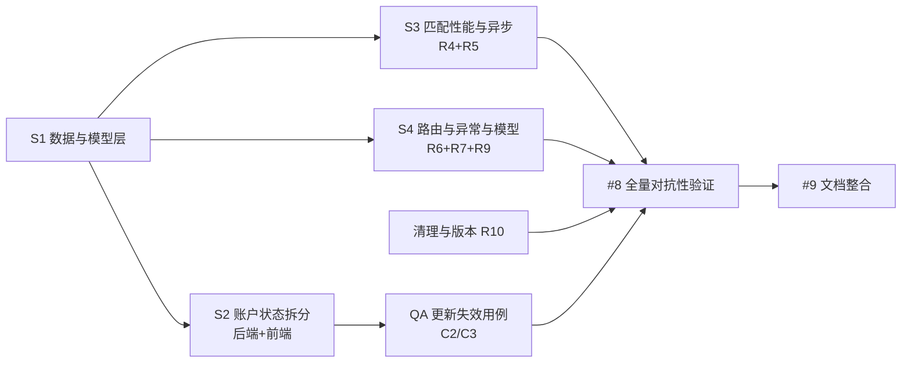

# 增量修复设计说明书 — 2026-09-12（批次二）

> 依据：[架构评审报告](architecture-review-2026-09-12.md) 的 P1/P2 遗留项 + [文档同步说明](doc-sync-2026-09-12.md) §5 的 C1/C2/C3。用户已拍板「全部去修」。
> **本文档只做设计，不含实现**。所有结论均已回读代码确认，标注 `文件:行号`。团队长给出的行号若与代码不符，以代码为准并已在下文标注。
> **范围控制**：不引入微服务 / 消息队列 / Redis / pgvector；R4 仅用「SQLite 列 + JSON」。

---

## 1. 范围与目标

| 编号 | 一句话目标 | 类型 |
|------|-----------|------|
| **C1** | 公开物品接口解析出的 `disabled`/`deleted` viewer **降级为匿名**，不再以「属主」身份看到未审核数据 | 鉴权语义 |
| **C2** | 新增独立 `users.status` 列，`role` 收敛为 `user/admin`；**修复「禁用管理员→启用后降级为普通用户」** | 数据结构 + 语义 |
| **R4** | 新增 `items.color_vector` 持久化 27 维颜色直方图，匹配时**免重复磁盘 IO** | 性能 |
| **R5** | 认领/驳回邮件改为**不阻塞事件循环** | 稳定性 |
| **R6** | 路由顺序从「隐性契约」变为**结构性保证**（`:int` 转换器） | 健壮性 |
| **R7** | 去掉裸 `except: pass`，修正 `count` 失真，统一用 `BackgroundTasks` 调度匹配 | 可观测性 |
| **R9** | 6 个裸 dict 端点补 Pydantic 请求模型，**行为向后兼容** | 规范 |
| **R10** | 清理死代码、统一版本号 | 整洁度 |
| **C3** | 更新 2 处过期测试注释、修复因 C2 失效的用例 | 测试（交 QA） |

---

## 2. 数据结构变更

### 2.1 `users` 表新增 `status`

| 列 | 类型 | 取值 | 默认 | 说明 |
|----|------|------|------|------|
| `role` | TEXT | `user` / `admin` | `user` | **仅授权角色**（语义收敛） |
| `status` | TEXT | `active` / `disabled` / `deleted` | `active` | **账号状态**（新增） |

- 建表语句（`database.py:43-53`）增加 `status TEXT DEFAULT 'active'`（放在 `role` 之后）。
- **不加 SQLite `CHECK`**：SQLite 对 `ALTER TABLE ADD COLUMN` 加 CHECK 支持受限，且原表 `role` 本无 CHECK；取值约束由应用层保证（Design 目的：迁移简单、可控）。

### 2.2 `items` 表新增 `color_vector`

| 列 | 类型 | 内容 | 默认 |
|----|------|------|------|
| `color_vector` | TEXT | 27 维 L1 归一化颜色直方图，JSON 数组（复用 `vector_to_json`） | NULL |

- 建表语句（`database.py:56-79`）增加 `color_vector TEXT`。
- **不建索引**：颜色向量不参与 SQL 过滤，仅在应用层计算相似度。

### 2.3 幂等迁移方案（`database.py::init_db`）

> 约束：`init_db()` 在 `lifespan` 每次启动执行（`main.py:15`）；数据库非空（`backend/lost_found.db` 有真实数据）；迁移必须**可重复执行且无副作用**。

**迁移 1：`users.status`**

```text
PRAGMA table_info(users) → user_columns
if 'status' not in user_columns:                      # 仅在列不存在时进入（天然幂等）
    ALTER TABLE users ADD COLUMN status TEXT DEFAULT 'active'
    # 一次性数据映射（因仅在“新增列”分支内执行，故只跑一次）
    UPDATE users SET status='disabled', role='user' WHERE role='disabled'
    UPDATE users SET status='deleted',  role='user' WHERE role='deleted'
    UPDATE users SET status='active'                 WHERE status IS NULL   # 兜底
```

- **幂等性来源**：映射写在 `if 'status' not in columns` 分支内，列一旦存在则整段跳过，重复启动不再改写。
- **老数据映射**：`role='disabled'` → `status='disabled'` + `role='user'`；`role='deleted'` → `status='deleted'` + `role='user'`；其余 → `status='active'`。

> ⚠️ **不可恢复信息（必须在设计/发布说明中写明）**：旧逻辑把 `role` 直接覆写为 `disabled`，**原授权角色已丢失**。因此被禁用的**管理员**迁移后只能还原为普通用户 `role='user'`，无法自动复原其管理员身份。影响面：仅历史中「曾被禁用过的账号」；迁移后需管理员手工重新授权。此点请主理人/用户确认（见 §9 O1）。

**迁移 2：`items.color_vector`**

```text
PRAGMA table_info(items) → columns
if 'color_vector' not in columns:
    ALTER TABLE items ADD COLUMN color_vector TEXT      # 老数据为 NULL，由回填处理
```

### 2.4 索引影响

- 无新增索引（`status` 与 `color_vector` 均非高频过滤键）。
- **可选**（数据量增长后再评估）：`CREATE INDEX IF NOT EXISTS idx_users_status ON users(status)`——`get_users` 的 `status != 'deleted'` 过滤可受益，但当前数据量下收益不显著，本轮**不做**。

---

## 3. 接口契约变更

### 3.1 响应结构变化（后端 → 前端）

| 端点 | 现状 | 变更后 | 兼容性 |
|------|------|--------|:------:|
| `POST /api/login` | `user: {id, username, role}`（`auth.py:82-91`） | 增加 `status` → `{id, username, role, status}` | 加字段，**向后兼容** |
| `POST /api/register` | `user: {id, username}`（`auth.py:57-62`） | 增加 `role`、`status` → `{id, username, role, status}` | 加字段，兼容 |
| `GET /api/me` | `user: {id, username, role, phone, email, created_at}`（`auth.py:99-110`） | 增加 `status` | 加字段，兼容 |
| `GET /api/admin/users` | 每行含 `role`，用 `role` 表示 禁用/注销（`admin.py:284-295,305`） | `role` 仅含 `user/admin`；新增 `status` 字段；过滤条件由 `role != 'deleted'` 改为 `status != 'deleted'` | **破坏性**（见 §3.2） |
| `PUT /api/admin/users/{id}` | `action=set_role|toggle_status` 读写 `role`（`admin.py:308-342`） | 命令名不变；`toggle_status` 改为翻转 `status`（`active`↔`disabled`），**`role` 保持不变** | 命令名兼容，语义修正 |
| 物品相关端点（含 `GET /items/`、`GET /items/{id}`） | 响应字段不变 | 不变（C1 仅影响「属主判定」，不改响应结构） | 兼容 |
| 6 个裸 dict 请求端点（§4.7） | 请求体无模型 | 增加 Pydantic 模型，**字段与可选性逐一保持等价** | 兼容（详见 §4.7） |

### 3.2 前端必须同步改的点（逐条：文件 + 位置）

> 判定依据：`GET /api/admin/users` 将**不再用 `role` 表达 disabled/deleted**；旧前端若仍读 `role` 会把禁用/注销用户显示为「用户」。

| # | 文件 | 位置 | 现状 | 改为 | 原因 |
|---|------|------|------|------|------|
| F1 | `lost-found-frontend/src/router/index.js` | 第 77 行 | `authStore?.user?.role === 'disabled'` | `authStore?.user?.status === 'disabled'` | 禁用态迁到 `status` |
| F2 | `lost-found-frontend/src/views/AdminView.vue` | 第 154-160 行（角色列） | `row.role==='admin'` / `==='disabled'` / `==='deleted'` 三态判断 | `admin` 看 `row.role`；`已禁用` 看 `row.status==='disabled'`；`已注销` 看 `row.status==='deleted'` | 拆分后 role/status 各表其义 |
| F3 | `lost-found-frontend/src/views/AdminView.vue` | 第 167 行 | `v-if="row.role !== 'deleted'"` | `v-if="row.status !== 'deleted'"` | 同上 |
| F4 | `lost-found-frontend/src/views/AdminView.vue` | 第 172-183 行（操作下拉） | `disable` 条件 `role==='user'||role==='admin'`；`enable` 条件 `role==='disabled'` | `disable` 条件改为 `status==='active'`；`enable` 条件改为 `status==='disabled'`；`set-admin/unset-admin` 仍看 `role` | 同上 |
| F5 | `lost-found-frontend/src/views/AdminView.vue` | 第 563 行 `rowClassName` | `row.role === 'deleted'` | `row.status === 'deleted'` | 同上 |

**无需改动**（已核实）：
- `stores/auth.js`：`setAuth/fetchUser/restore` 存的是整个 user 对象，`status` 会自动带上；`isAdmin = role==='admin'` 仍成立（`stores/auth.js:15,30,44`）。
- `views/LoginView.vue:107`、`views/ProfileView.vue:11`：仅按 `role==='admin'` 分流/展示，语义未变。
- `api/admin.js`：`set_role`/`toggle_status` 命令名未变，无需改。

**合计需要同步修改：2 个前端文件、5 处。**

### 3.3 后端必须同步改的点（C2 涉及面）

| 文件 | 位置 | 现状 | 改为 |
|------|------|------|------|
| `app/database.py` | 43-53 建表 / 110-122 迁移区 | 无 `status` | 建表加列 + 幂等迁移（§2.3） |
| `app/api/auth.py` | 70（login SELECT）、79（disabled 拦截）、82-91（响应）、99-110（get_me SELECT/响应）、197（delete_account 写 `role='deleted'`） | 全用 `role` | SELECT/写入/响应改用 `status`；登录 403 由 `status=='disabled'` 判定 |
| `app/dependencies/auth.py` | 46（SELECT）、54、59-63 | 只 SELECT `id, role`；两个 403 分支判 `role` | SELECT `id, role, status`；两分支改判 `status` |
| `app/api/admin.py` | 271（过滤）、284-295（SELECT）、305（返回）、322-327（取现有 role/拦截）、328-332（set_role）、333-339（toggle_status）、394-401（delete_user 写 `role='deleted'`） | 全用 `role` | 过滤/返回/拦截/删除改用 `status`；`toggle_status` 只改 `status` 保留 `role`；`set_role` 只改 `role` |

> **C2 核心修复点**：`admin.py:333-339` 的 `new_role = "user" if u["role"] == "disabled" else "disabled"`（覆写 role）→ 改为
> `new_status = "active" if u["status"] == "disabled" else "disabled"`，`UPDATE users SET status=? WHERE id=?`。**role 不再被动**。

---

## 4. 关键设计决策与取舍

### 4.1 C1：共享辅助函数（选它，否决「两处各写一遍」）

**决策**：在 `app/dependencies/auth.py` 新增 `resolve_optional_viewer(request) -> Optional[dict]`，返回 `{"user_id": int, "role": str}` 或 `None`。

```python
def resolve_optional_viewer(request: Request) -> Optional[Dict[str, Any]]:
    """公开接口的可选身份解析：无/非法 token 或 status!='active' → None（匿名）。"""
    auth = request.headers.get("Authorization", "")
    if not auth.startswith("Bearer "):
        return None
    payload = verify_token(auth[7:])
    if not payload:
        return None
    with get_db_connection() as conn:
        cur = conn.cursor()
        cur.execute("SELECT id, role, status FROM users WHERE id=?", (payload.get("user_id"),))
        row = cur.fetchone()
    if not row or row["status"] != "active":
        return None                     # disabled / deleted → 降级为匿名
    return {"user_id": row["id"], "role": row["role"]}
```

- **调用点替换**：`items.py:142-147`（get_items）与 `items.py:231-241`（get_item）删除手写解析，改用该函数。
- **为什么选它 / 否决了什么**：
  - ✅ 单一实现，消除两处重复；未来新增公开接口可直接复用。
  - ✅ 返回 `role` 让 `get_item` 仍能判管理员（`items.py:240` 的 `is_admin` 逻辑保留）。
  - ❌ 否决「在两处各写一遍校验」：重复且易漏，正是评审 §2.3 批评的重复实现模式。
  - ❌ 否决「用 `Depends(get_current_user)` 但捕获 401/403」：会强制公开接口需要登录，破坏公开性。

### 4.2 C2：`role`/`status` 拆分（选它，否决单列 + 编码）

- ✅ **选**：新增 `status` 列，职责单一；`toggle_status` 不再触碰 `role`，从根上消除「禁用管理员→降级」。
- ❌ 否决「继续用单列，加前缀编码（如 `admin_disabled`）」：解析复杂、易错、迁移更麻烦。
- ❌ 否决「新增 `is_disabled` 布尔 + 保留 `deleted` 在 role」：仍有两种状态源，语义未收敛。
- **迁移代价**：`role='disabled'` 的账号原角色不可恢复（§2.3），已在文档显式声明。

### 4.3 R4：颜色回填策略（选「一次性脚本 + 读回退」，否决写透）

- ✅ **选**：新增 `backend/scripts/backfill_color_vectors.py`（一次性、幂等：`SELECT id,image_path WHERE color_vector IS NULL AND image_path IS NOT NULL` → 计算 → `UPDATE`），**同时**匹配读路径保留「缺失则实时计算」回退。
- **理由**：① 匹配热路径保持**只读**，避免 N 次并发写触发 SQLite 写锁争用（评审 §4.1 已指出写锁风险）；② 回退保证「忘记跑脚本也不炸」；③ 回退只在**尚未回填的老数据**上发生，跑完脚本后完全消失。
- ❌ 否决「读时写透（lazy write-through）」：会在匹配循环里插入 N 次 `UPDATE`，与「消除 IO」的初衷相悖，且引入写锁。
- **写入时机**：新数据在 `create_item`（`items.py:95` 附近）与 `update_item` 换图时（`items.py:360-369`）同步算 `color_vector` 并入库；`update_item` 初始 fetch（`items.py:313`）需补 `SELECT color_vector`，未换图时保留原值（避免脏数据）。

### 4.4 R5：邮件异步方案（选 BackgroundTasks，否决 run_in_threadpool）

- ✅ **选**：`claim_item`（`items.py:565-652`）新增 `background_tasks: BackgroundTasks` 参数，`items.py:648` 的 `send_email(...)` 改为 `background_tasks.add_task(send_email, ...)`；`review_item` 驳回分支（`admin.py:244`）同样改为 `add_task`（该端点已有 `background_tasks` 参数，`admin.py:149`）。
- **理由**：① 语义上邮件是「通知」，响应可先返回（claim 提示「申请已发送」即符合预期）；② Starlette 的 `BackgroundTasks` 对**同步 callable 会自动放入线程池执行**，不阻塞事件循环；③ `review_item` 已在用 `BackgroundTasks` 跑匹配（`admin.py:216`），保持一致；④ `send_email` 内部已捕获异常（`email_utils.py:28-33`），后台失败不会冒泡。
- ❌ 否决「`await run_in_threadpool(send_email, ...)`」：虽也不阻塞，但仍让用户响应**等待 SMTP 往返**（最坏 10s 超时），体验差于后台化。

### 4.5 R6：路由选型（选 `:int` 转换器，否决「仅靠顺序」）

- ✅ **选**：给数字型路径参数加 Starlette 转换器，例如 `@router.get("/{item_id:int}")`。转换器把该路由的正则收窄为 `[0-9]+`，`/categories`、`/match`、`/temp-upload` 等静态段**根本不会匹配**数字路由，**从结构上消除顺序依赖**。
- **改动点**：`items.py` 的 `GET /{item_id}`(221)、`PUT /{item_id}/mark-claimed`(257)、`PUT /{item_id}`(302)、`DELETE /{item_id}`(421)、`POST /{item_id}/claim`(565) → 全部加 `:int`；`admin.py` 的 `PUT /reviews/{item_id}`(145)、`PUT /users/{user_id}`(308)、`DELETE /users/{user_id}`(379)、`PUT /items/{item_id}/status`(458)；`notifications.py` 的 `PUT /{notif_id}/read`(41)。

> 代码核实：当前路由用默认 `str` 转换器（正则 `[^/]+`），故 `/categories` 会先命中 `/{item_id}` 再因 `int` 强制转换失败 → **422**（这正是 CHANGELOG Bug #4/#7 的机制）。加 `:int` 后该路径直接跳过数字路由，落到 `/categories`。

- ❌ 否决「只加注释、仍靠排列顺序」：治标不治本，已复发两次。
- ❌ 否决「给静态路由加独立前缀如 `/meta/categories`」：改动面更大且会让前端 API 路径变动，收益不匹配。
- **保留**：静态路由仍**声明在**参数化路由**之前**（双保险，且便于阅读）。

### 4.6 R7：调度方式（选 BackgroundTasks，否决裸 `create_task` + `except: pass`）

- ✅ **选**：`update_item_status`(458) 与 `batch_items`(510) 新增 `background_tasks` 参数，把 `asyncio.create_task(asyncio.to_thread(auto_match_and_notify, ...))` 改为 `background_tasks.add_task(auto_match_and_notify, ...)`；删除 `import asyncio` 与裸 `except: pass`（`admin.py:489-492`、`531-540`）。
- **理由**：① 与 `review_item` 调度方式一致；② 若有异常，Starlette 会记录（不再被 `except: pass` 吞掉）；③ 由框架在响应后统一调度，比手工 `create_task` 更可观测、无「无运行 loop」隐患。
- **`count` 失真修正**（`admin.py:560`）：改为按分支取真实受影响行数——
  - `approve`：`count = cur.rowcount`（紧跟 L527 的 UPDATE，其 `WHERE review_status='pending'` 已保证是真实通过数）；
  - `close`：`count = cur.rowcount`（L544）；
  - `delete`：`count = cur.rowcount`（L558 的 DELETE）。
  即在**每个分支内**各自记录 rowcount，而非在函数末尾取最后一次语句的行数。

### 4.7 R9：请求模型（选「宽松模型 + 保留原有 400 校验」，否决「严格模型改 422」）

统一原则：**模型只做结构声明，不给约束**（避免把现有 400 变成 422、把可选字段变成必填），原有手写校验与错误码全部保留，确保行为等价。

| 端点 | 现有行为 | 新增模型 | 等价性 |
|------|----------|----------|:------:|
| `PUT /api/me`（auth.py:114-181） | `payload: dict`；按 key 存在与否分支；空→400「没有需要更新的字段」；长度/格式→400 | `ProfileUpdate(username/password/email/phone: Optional[str] = None)` | ✅ 等价（分支逻辑不变） |
| `POST /admin/reviews/batch-approve`（admin.py:87-142） | `payload.get("item_ids", [])`；空→400；>50→400 | `BatchApproveRequest(item_ids: list[int] = [])` | ✅ 等价 |
| `PUT /admin/users/{id}`（admin.py:308-342） | `action`/`role`；`action` 非二值→400；`set_role` 时 `role` 缺省为 `"user"` | `UserUpdateRequest(action: str, role: Optional[str] = None)`；handler 用 `role if role is not None else "user"` | ✅ 等价（**注意**：不可写成 `role or "user"`，否则 `""` 会被当成合法值，与现状不符） |
| `POST /admin/users`（admin.py:345-376） | `username/password/phone/email/role`；缺省 `""`/`"user"`；长度→400 | `AdminCreateUserRequest(username: str = "", password: str = "", phone: str = "", email: str = "", role: str = "user")` | ✅ 等价（`.strip()` 与校验留在 handler） |
| `POST /admin/items/batch`（admin.py:510-562） | `ids`/`action`；空或 action 非三值→400 | `BatchItemsRequest(ids: list[int] = [], action: str = "")` | ✅ 等价 |
| `PUT /admin/items/{id}/status`（admin.py:458-507） | `status`；非三值→400 | `ItemStatusUpdate(status: str = "")` | ✅ 等价 |

- ❌ 否决「给模型加 `min_length`/`pattern`/`Literal` 等约束」：会把手写 400 变 422，破坏前端既有错误处理（`utils/request.js:23` 只读 `detail`）。
- **顺带可做（可选）**：`announcements.py:57,79` 的 `payload: dict` 同属一类问题，可用同模式补 `AnnouncementRequest`；团队长 R9 列表未列，标为可选。

---

## 5. 模块改动清单（逐文件）

### 5.1 后端

| 文件 | 位置 | 改动 |
|------|------|------|
| `backend/app/database.py` | 43-53 / 56-79 / 110-160 | users 建表加 `status`；items 建表加 `color_vector`；新增 2 段幂等迁移 + 一次性数据映射；删除 `uploads/avatars/` 创建（160） |
| `backend/app/dependencies/auth.py` | 31-86 + 新增函数 | `get_current_user` SELECT 加 `status`、两 403 分支改判 `status`；新增 `resolve_optional_viewer()` |
| `backend/app/api/auth.py` | 70/79/82-91/99-110/197 | login SELECT + 拦截 + 响应改 `status`；get_me 加 `status`；register 响应补 `role/status`；delete_account 写 `status='deleted'` |
| `backend/app/api/items.py` | 95/114-120/142-147/221/231-241/257/302/313/360-405/421/493-497/507/565/648 | create/update 写入 `color_vector`；get_items/get_item 改用 `resolve_optional_viewer`；数字路由加 `:int`；match SELECT 加 `color_vector` 并优先取库；claim 邮件改 BackgroundTasks |
| `backend/app/services/match_service.py` | 20/33/55-61 | SELECT 加 `color_vector`；优先取库、缺失回退计算 |
| `backend/app/api/admin.py` | 87/145/244/271/284-342/379-401/458-562/308 | 用户状态改 `status`；toggle_status 只改 status；驳回邮件改 BackgroundTasks；items 数字路由加 `:int`；去裸 except + 改 BackgroundTasks；修正 count；6 端点接 Pydantic 模型 |
| `backend/app/api/notifications.py` | 41 | `PUT /{notif_id}/read` 加 `:int` |
| `backend/app/models/user.py` | 33 + 新增 | 删除未用 `UserResponse`；新增 `ProfileUpdate` |
| `backend/app/models/admin.py`（新建） | — | `BatchApproveRequest` / `UserUpdateRequest` / `AdminCreateUserRequest` / `BatchItemsRequest` / `ItemStatusUpdate` |
| `backend/app/models/item.py` / `notification.py` / `common.py` | 全文件 | **删除**（未被引用；`common.PagedResponse` 仅在 `admin.py:14` import 后未用 → 同步删 import） |
| `backend/app/models/match.py` | 14-26 | 删除未用 `MatchResult/MatchResponse/MatchConfirm`，保留 `MatchRequest` |
| `backend/scripts/backfill_color_vectors.py`（新建） | — | 一次性回填脚本（幂等） |
| `backend/app/config.py` | 23 + 新增 | 删除未生效的 `CORS_ORIGINS`；新增 `APP_VERSION` |
| `backend/app/main.py` | 24/31-39/41-47/75-81 | `version` 对齐 `APP_VERSION`；删除 `LocalhostRegexOrigin`（含 `import re`）；root 文案版本号对齐 |

### 5.2 前端

| 文件 | 位置 | 改动 |
|------|------|------|
| `lost-found-frontend/src/router/index.js` | 77 | 禁用判定改 `user.status === 'disabled'`（F1） |
| `lost-found-frontend/src/views/AdminView.vue` | 154-160 / 167 / 172-183 / 563 | 用户表角色列与操作按 `status` 判定（F2–F5） |

### 5.3 测试（交 QA）

| 文件 | 位置 | 改动 |
|------|------|------|
| `backend/tests/conftest.py` | 119-147 `make_user` | 增加 `status` 参数；`role in ('disabled','deleted')` 时写 `status` 并置 `role='user'`（让多数用例体不变） |
| `backend/tests/test_auth.py` | 69-70（SQL 改 status）、60-61（注释） | 见 §6.2 |
| `backend/tests/test_adversarial_auth.py` | 14-15 / 25-26 / 83-84（SQL 改 status） | 见 §6.2 |
| `backend/tests/test_adversarial_admin_toggle.py` | 26-51 | 断言改 `status`；语义由「复现 bug」翻转为「回归守护」 |
| `backend/tests/test_stats.py` | 37 | 更新过期 docstring |

---

## 6. 任务列表（实现顺序 + 依赖 + 验收标准）

> 说明：团队长已建宏观任务 #7（实现）/ #8（对抗性验证）/ #9（文档整合）。以下 S1–S5 是 **#7 的工作包分解**，QA 步骤归 #8，文档归 #9。工作包按依赖排序。



| 步骤 | 名称 | 涉及文件 | 依赖 | 验收标准 |
|:----:|------|----------|:----:|----------|
| **S1** | 数据与模型层 | `database.py`、`models/*`（清理+新增） | — | `init_db()` 连跑两次无副作用；`PRAGMA table_info` 可见 `users.status`、`items.color_vector`；老库迁移后无异常 |
| **S2** | 账户状态语义拆分 | 后端 `auth.py`/`dependencies/auth.py`/`admin.py`；前端 `router/index.js`、`AdminView.vue` | S1 | 「禁用管理员→启用」后 `role` 仍为 `admin`（C2 修复）；禁用/注销账号调受保护接口 403；前端用户表正确显示禁用/注销 |
| **S3** | 匹配性能与异步 | `items.py`、`match_service.py`、`scripts/backfill_color_vectors.py` | S1 | 新物品入库即含 `color_vector`；换图后 `color_vector` 同步更新；匹配优先取库、缺失可回退；claim/驳回响应不再等待 SMTP |
| **S4** | 路由/异常/请求模型 | `items.py`、`admin.py`、`notifications.py`、`models/admin.py`、`models/user.py` | S1 | `/api/items/categories` 等静态路径恒可达（R6）；批量操作 `count` 反映真实行数；6 端点请求体在 Swagger 可见且行为与改前一致 |
| **S5** | 清理与版本 | `main.py`、`config.py`、`database.py`、`models/*` | — | 全仓无裸 `except: pass`；无未引用模型；`/` 与 OpenAPI 版本号一致 |
| **QA-1** | 更新失效用例 +（C3）注释 | `tests/conftest.py`、`test_auth.py`、`test_adversarial_auth.py`、`test_adversarial_admin_toggle.py`、`test_stats.py` | S1、S2 | 45 用例（调整后）全绿；C2 用例翻转为「role 保留 admin」回归守护 |
| **QA-2** | 全量对抗性验证（#8） | `tests/` | S2–S5、QA-1 | 全绿 + 针对 C1/C2/R4–R7 新增对抗用例 |
| **DOC** | 文档整合（#9） | `PROJECT.md`/`README.md`/`CHANGELOG.md` | QA-2 | 接口表、DB 设计、版本演进与代码一致 |

**关键依赖链**：S1 → (S2 → QA-1) 与 (S3, S4, S5) → QA-2 → DOC。
**并行机会**：S3、S4、S5 彼此独立，可在 S1 完成后并行；S2 因文件与 S1 重叠需紧随 S1。

### 6.2 会让既有测试失效的用例清单（交 QA）

| 用例 | 失效原因 | 应改成 |
|------|----------|--------|
| `test_auth.py::test_disabled_user_old_token_is_rejected`（L69-70） | SQL `UPDATE users SET role='disabled'`；拆分后禁用态在 `status` | 改 `UPDATE users SET status='disabled'` |
| `test_auth.py::test_login_disabled_user_403`（L40） | `make_user(role='disabled')` 写 `role` | 依赖 conftest 新 `status` 映射（conftest 改后此用例体可不改） |
| `test_adversarial_auth.py::test_disabled_admin_old_token_403_not_500`（L14-15） | SQL 写 `role='disabled'` | 改 `status='disabled'` |
| `test_adversarial_auth.py::test_disabled_user_token_write_endpoint_403`（L25-26） | 同上 | 改 `status='disabled'` |
| `test_adversarial_auth.py::test_login_disabled_user_still_403_after_fix`（L57） | `make_user(role='disabled')` | 依赖 conftest 映射 |
| `test_adversarial_auth.py::test_disabled_user_token_still_recognized_by_public_item_endpoints_residual`（L83-84） | SQL 写 `role='disabled'`；且 **C1 修复后行为反转**（公开接口不再放行禁用用户） | 改 `status='disabled'`；断言改为「公开列表/详情对禁用 token **不**返回其 pending 物品」（C1 生效） |
| `test_adversarial_admin_toggle.py::test_toggle_status_downgrades_admin_existing_issue`（L26-51） | 现断言「启用后 role 被写成 user」= 编码了 bug | 改为：禁用后 `status=='disabled'`；启用后 `status=='active'` **且 `role=='admin'`**（C2 回归守护） |
| `test_auth.py::test_disabled_user_old_token_is_rejected`（docstring L60-61）、`test_stats.py::test_today_lost_counts_beijing_early_morning_item`（docstring L37） | 「预期失败」注释已过期（C3） | 改为「回归守护」措辞 |

> 其余 37 个用例**不受影响**：R4/R5/R6/R7/R9 的改动已逐一核对不影响既有断言（R6 路由用例在加 `:int` 后仍通过；邮箱在 conftest 已被 stub；批量 count 未被测试直接断言）。

---

## 7. 依赖包变化

**无新增依赖。**
- `BackgroundTasks`：`fastapi` 内置（`admin.py:6` 已在用）。
- Pydantic v2：项目已依赖（`requirements.txt` 经 `fastapi`/`pydantic-settings` 引入，且 `app/models/` 已在用）。
- 回填脚本仅用 `PIL`/`numpy`（`clip_service.py` 既有依赖）。

---

## 8. 共享知识（跨文件约定）

1. **账号状态枚举**：`status ∈ {active, disabled, deleted}`，默认 `active`；**任何**权限/可见性判定一律看 `status`，授权级别看 `role`。
2. **授权角色枚举**：`role ∈ {user, admin}`，默认 `user`；不再出现 `disabled`/`deleted` 取值。
3. **登录门禁**：`status=='disabled'` → 403「账号已被禁用」；`status=='deleted'` → 403「账号已注销」（防御性，用户名后缀已使其无法正常登录）。
4. **公开接口身份**：统一经 `resolve_optional_viewer(request)`；`status!='active'` 一律返回 `None`（匿名）。
5. **颜色向量存储格式**：`items.color_vector` = 27 维 float 的 JSON 数组（`vector_to_json` 输出），L1 归一化；缺失（NULL）时按 `image_path` 实时计算回退。
6. **迁移调用时机**：全部在 `database.init_db()` 内，经 `PRAGMA table_info` 守卫，随 `lifespan` 启动执行；**不得**在请求路径中做 DDL。
7. **异步通知约定**：邮件/匹配通知一律走 `BackgroundTasks.add_task`（同步 callable 自动进线程池），不在 async 端点内直接调用阻塞 IO。
8. **路由约定**：数字路径参数一律用 `{name:int}`；静态路由仍声明在参数化路由之前。
9. **前端契约**：`user`（login/register/me）含 `status`；`/admin/users` 每行含 `role`（仅 user/admin）与 `status`；前后端**必须同批次部署**。

---

## 9. 待明确事项（需主理人 / 用户裁决）

| # | 问题 | 影响 | 我的建议 |
|---|------|------|----------|
| O1 | 历史中 `role='disabled'` 账号的**原授权角色不可恢复**（旧逻辑已覆写），迁移统一置 `role='user'`。是否接受？ | 曾被禁用的管理员迁移后需手工重新授权 | 接受，并在发布说明标注 |
| O2 | `toggle_status` 是否允许「禁用管理员」？是否需要「不能禁用/删除自己」的保护？（现有代码无自保护，`delete_user` 仅禁删自己） | 越权/误操作风险 | 至少对「禁用自己」加保护；是否允许禁用管理员请裁决 |
| O3 | `config.CORS_ORIGINS`：**删除**还是**接线**（与 `allow_origin_regex` 并存）？ | 配置清晰度 | 建议**删除**（当前 regex 已满足开发需求） |
| O4 | `models/` 清理范围：删除 `item.py`/`notification.py`/`common.py`、裁剪 `user.py`(`UserResponse`)/`match.py`(3 个未用类)，是否认可？ | 删代码有轻微回归风险（QA 会验证） | 认可则删；否则保留并标注「预留」 |
| O5 | R4 回填采用「一次性脚本 + 读回退、不自动写回」，是否接受？ | 需运维手动跑一次脚本 | 接受（保持匹配只读） |
| O6 | 本轮是否推进版本号到 **v3.4.0**？ | 三份文档版本一致性 | **建议 v3.4.0**：含 schema 变更（新增 2 列）+ 语义变更（role/status 拆分）+ 契约变化，属 minor 递进 |
| O7 | 前端与后端**必须同批次发布**（`/admin/users` 返回结构变更），部署是否允许整体发布？ | 若前后端独立发布会有短暂不兼容 | 建议整体发布 |
