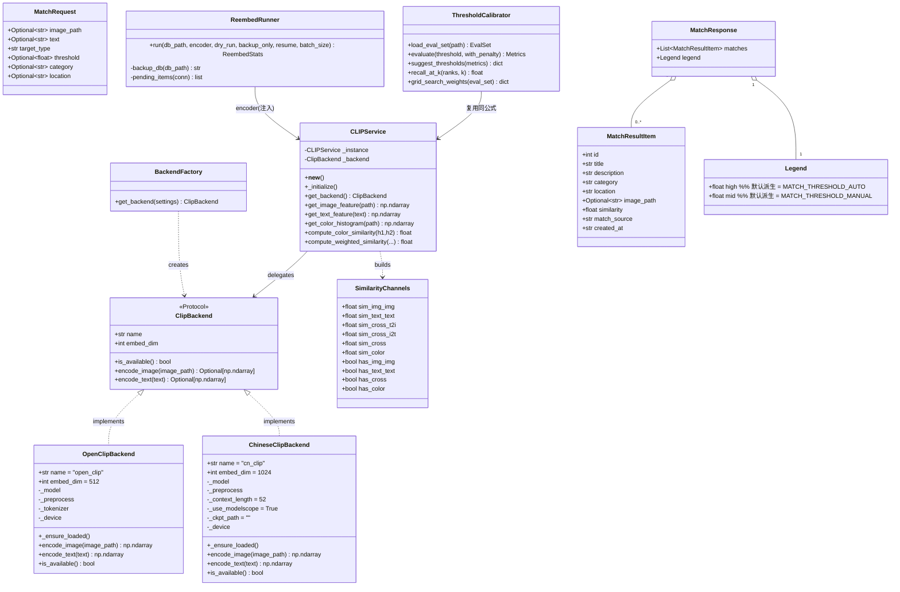
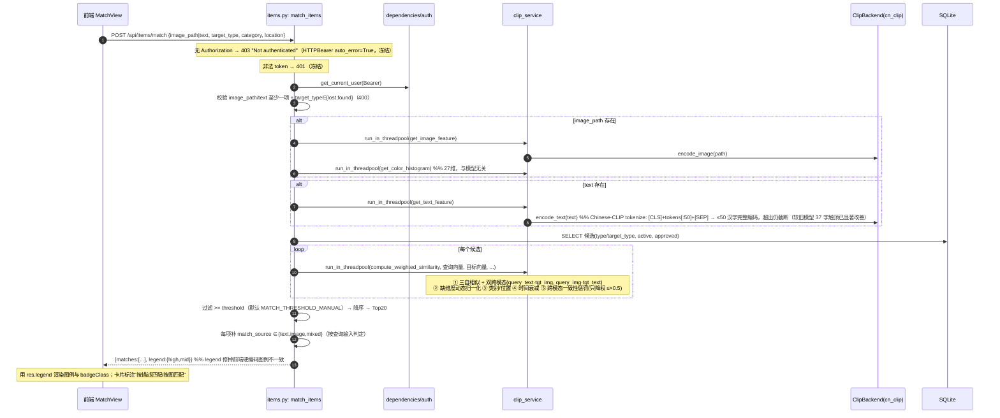
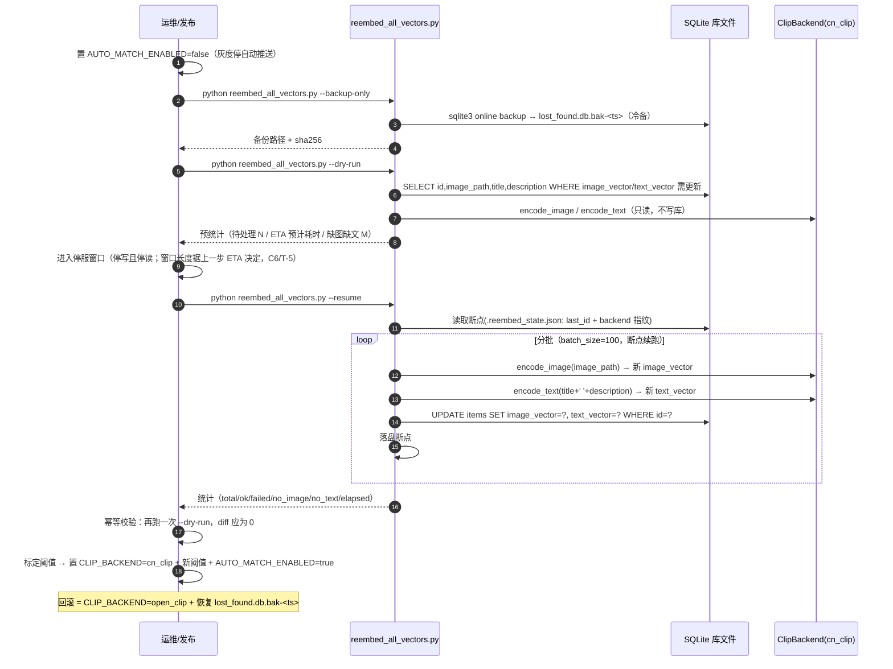
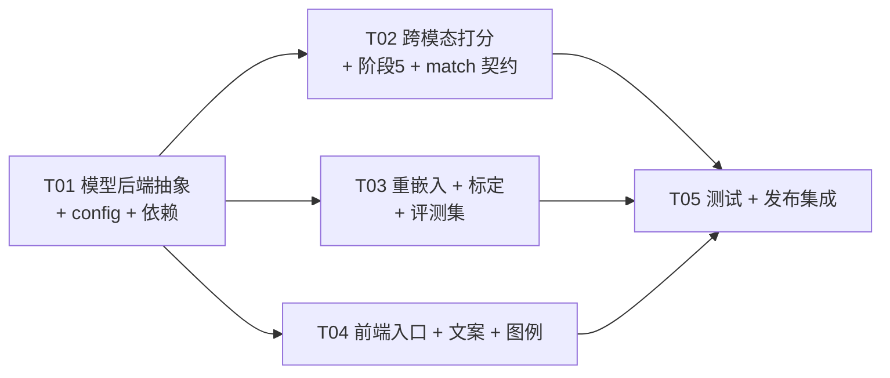

# 校园智能失物检索平台 — v3.5.0 增量架构设计说明书

> **版本**：v1.3 | **日期**：2026-09-14 | **作者**：架构（高见远）
> **范围**：`v3.4.1 → v3.5.0`——**中文化模型替换（open_clip ViT-B-32 → Chinese-CLIP ViT-H/14）+ 图文跨模态检索启用 + 阈值重标定与可回滚参数化**。
> **上游依据**：[增量 PRD](../product/PRD-v3.5.0-incremental.md)（产品 许清楚）+ team-lead 已裁决的 9 项（Q1–Q9）+ **team-lead 逐文件实证反馈 C1–C6、C7 与 T-1~T-7 裁决（已并入）**。
> **本文档只做设计，不含实现**。所有代码结论均已回读源码与真实行号确认。
> **v1.1 变更**：C1 修正 `cn_clip` 权重下载源（删除错误的"阿里云 OSS"论述，改为 HF Hub / ModelScope / 本地 `.pt` 三路径）；C2 增补 `--no-deps` 安装策略；C3 修正文本上限表述（≤50 汉字，非"不截断"）；C4 增补 pip 打包风险与 git 源兜底；C5 图例改为阈值派生；C6 并入 T-1~T-7 裁决。
> **v1.2 变更（按实测库规模校正 C7）**：C7-a 评测集 **80→40 对**（20 正/20 负，**构造式**——全库仅 6 条 item 抽样不可行），去 `item_ref` 改引真实 `items`；C7-b §5.8 停服窗口**<1 分钟**（删"小时级"），`--dry-run` ETA 保留但不据此调优；C7-c 补 `/match` 仅扫 6 候选的性能事实依据，明文**禁止**引入向量库/ANN/预筛 Top-N。
> **v1.3 变更（按代码实现与实测澄清校正 · 2026-09-14）**：**F1** 修正 **Chinese-CLIP 输出维度 512→1024**（`cn_clip` 的 `embed_dim` 是**联合投影维度**、非视觉塔宽度 `vision_width`；ViT-H-14 为 1024，`open_clip ViT-B-32` 仍 512），并补「**维度错配是静默失败**」风险说明与两道运行期防线（`clip_backend._assert_embed_dim` 编码后断言 + `/match` 打分前维度预检 §5.9）；**F2** 修正旧 `open_clip ViT-B-32` 的**中文可用字数 33→37**（`encode→decode` 回读实测，非 eot 位置判定；旧写法「33」会假阳）；**F3** 评测集**由 40 扩至 60 对**（30 正 / 30 负，含 **P25–P30 共 6 对「同图自比」退化对**，标定计算**排除**，**有效标定集 = 24 正 / 30 负**），并追加**裁决 A / 裁决 B**（§9）。
> **定位**：本文件是"可动手实现"的施工图——给出**具体值**（权重/阈值起点/字段名/文件名）。凡**必须靠评测集收敛**的参数，均显式标注「**初值，需评测收敛**」。

---

## 0. 阅读指引与关键结论速览

| 编号 | 议题 | 结论（一句话） | 章节 |
|:--:|------|------|:--:|
| **D1** | 模型集成路径 | **选 `cn_clip`（OFA-Sys 官方包）**，并抽 `ClipBackend` 协议 + `OpenClipBackend`/`ChineseClipBackend` 双实现，由 config 选择；权重下载走 **ModelScope / 本地 `.pt` 双路径**（默认非 HF Hub） | §1.2 |
| **D2** | 跨模态打分公式 | 新增 `img·text` 双通道（`query_text·target_img` / `query_img·target_text`），权重初值 `II 0.35 / CROSS 0.35 / TT 0.15 / COLOR 0.15`（**需评测收敛**） | §5.1 |
| **D3** | 阶段5 重构 | 改为**真跨模态一致性校验**：`penalty = f(cc)`，只降权、下限 `×0.5`、单调、config 可调、可关闭 | §5.2 |
| **D4** | 接口与返回契约 | **不新增端点**；`MatchRequest` 不扩字段；结果项**新增 `match_source`**；响应顶层**新增 `legend`（默认从阈值派生，修掉前端硬编码图例不一致）**；**403/401 契约不动** | §5.3 |
| **D5** | 重嵌入脚本 | `backend/scripts/reembed_all_vectors.py`：冷备 / `--dry-run`（**须输出 ETA**）/ `--backup-only` / 断点续跑 / 幂等 / 统计 / 打桩可测（依赖注入） | §5.4 |
| **D6** | 阈值标定 | `backend/scripts/calibrate_thresholds.py` + 评测集 `backend/eval/eval_set_v3.5.0.json`（**60 对：30 正 / 30 负，构造式**——实测全库仅 6 条 item，抽样不可行；含 **6 对「同图自比」退化对**，**标定计算排除**，**有效 24 正 / 30 负**；`category` 用 DB 7 真实类别名）；`--grid` 发布前必做；Recall@3<0.90 阻塞上报 | §5.5 |
| **D7** | config 参数化 | 完整新增项清单见 §5.6（模型后端 / 权重 / 阈值 / 惩罚 / 开关 / 版本号），`APP_VERSION → 3.5.0` | §5.6 |
| **D8** | 测试策略 | 72 条为何不受影响（单例方法名保留 → conftest 桩继续命中）+ 新增测试清单 + `RUN_REAL_CLIP` 门控 smoke test | §5.7 |
| **D9** | 发布与迁移 | 冷备 → 装依赖 → 预下权重 → 停自动推送 → **停服窗口** → 重嵌入 → 标定 → 启用 → 前后端同批 → 回滚预案 | §5.8 |
| **D10** | 任务列表 | **5 个任务（T01–T05）**，按依赖排序，含文件路径与验收点 | §7 |

**关键工程铁律（贯穿全文）**
1. **不得在模块 import 期导入 `cn_clip`**——必须 lazy import。否则 CI 未装 `cn_clip` 时全部 72 条测试在收集阶段即崩。见 §2.3。
2. **`CLIPService` 的公开方法名（`get_image_feature` / `get_text_feature` / `get_color_histogram` / `_initialize`）必须保留**——conftest 靠 monkeypatch 这些方法名阻断真实模型加载（`conftest.py:60-63`）。改名即测试全红。见 §5.7。
3. **新旧向量位于不同嵌入空间，不可混用**；`color_vector`（27 维）与模型无关，**不重算**。见 §5.4。
4. **不与 `open_clip` 共享顶层命名空间**（`cn_clip` 是独立顶层包）——回滚靠 config 切换，二者可共存。

---

## 1. 实现方案与选型（Implementation Approach）

### 1.1 核心技术难点

| # | 难点 | 说明 |
|:--:|------|------|
| D1 | **双模型栈共存 + 可回滚** | Q6/Q9 要求「切配置 + 恢复库文件」即可回滚到 `open_clip ViT-B-32`。故必须有**后端抽象**，业务代码不感知具体模型。 |
| D2 | **真跨模态通道从未算过** | 现 `compute_weighted_similarity`（`clip_service.py:119-121`）只算 `img1·img2` / `text1·text2` / `color1·color2`，**从不计算 `img·text`**。核心能力要从 0 补上，且三种输入（纯图/纯文/混合）行为确定、缺图缺文不崩。 |
| D3 | **阶段5 语义错误** | 现规则（`clip_service.py:154-159`）拿两个**自相似度**比大小，非跨模态。要重构为真跨模态一致性校验，且受「只降权 / ≤×0.5 / 单调 / 可配」硬约束（Q8）。 |
| D4 | **向量空间迁移** | 换模型后历史 `image_vector`/`text_vector` 失效，需一次性全量重嵌入；且要**幂等**、**断点续跑**、**可打桩测试**（`clip_service` 是单例懒加载，见环境约束）。 |
| D5 | **阈值随分布漂移** | 新模型的相似度分布与旧模型完全不同，三个阈值必须**在评测集上重标定**（Q1）。前端图例还与后端阈值本就割裂（`MatchView.vue:71-75` 硬编码 0.75/0.5 vs 后端 `MATCH_THRESHOLD_MANUAL=0.20`）。 |

### 1.2 D1 集成路径裁决：`cn_clip` vs HuggingFace `transformers`

| 比较维度 | **`cn_clip`（OFA-Sys 官方包）** | HuggingFace `transformers` `ChineseCLIPModel` |
|------|------|------|
| **依赖体积与安装确定性** | 包本身纯 Python；但 `setup.py` **硬钉 `lmdb==1.3.0`**（2020 年版本，**Windows 无预编译 wheel，会要求 MSVC 编译**）。`lmdb` **仅训练路径使用，推理完全不需要**（`cn_clip/clip/__init__.py` 只 import `bert_tokenizer` / `model.convert_state_dict` / `utils`）→ 安装须 **`pip install cn_clip --no-deps`**（见 C2）。运行期真实依赖 `numpy/tqdm/six/timm/torch/torchvision` 本项目**已全具备**（`timm` 是 `open-clip-torch` 的既有传递依赖）。 | 需新增 `transformers`（+`tokenizers` Rust 扩展、`huggingface-hub`、`safetensors`、`regex` 等）；体积显著更大，且可能强制 `tokenizers`/`numpy` 版本漂移。 |
| **API 与现有 `CLIPService` 贴合度** | **几乎 1:1 复刻 `open_clip`**：`load_from_name(name, device, download_root) → (model, preprocess)`；`model.encode_image(t)` / `model.encode_text(tokens)`；`clip.tokenize(texts, context_length=52)`。新后端与旧后端**形状一致**，抽象层最薄。 | API 不同：`ChineseCLIPModel.get_image_features(pixel_values)` / `get_text_features(**inputs)`，需 `ChineseCLIPProcessor` 包装，输出结构需二次提取；与 `open_clip` 写法不通用。 |
| **与 `open_clip` 能否共存（回滚要用）** | ✅ 顶层包名 `cn_clip` 与 `open_clip` **完全隔离**，可同进程共存，config 切换即可回滚。 | ✅ 亦能共存，但需额外管理 `transformers` 与 `torch` 的版本矩阵，回滚面更大。 |
| **首次下载来源 / 离线可行性（国内网络）** | ⚠️ **不是**阿里云 OSS。`cn_clip/clip/utils.py::_download(modelname, root, use_modelscope=False)` 默认分支 `use_modelscope=False` → `from huggingface_hub import hf_hub_download` → `hf_hub_download("OFA-Sys/chinese-clip-vit-huge-patch14", filename="clip_cn_vit-h-14.pt", local_dir=root)`，**默认走 HuggingFace Hub**；可选 `use_modelscope=True` → `model_file_download(model_id="AI-ModelScope/chinese-clip-vit-huge-patch14", ...)`（**需 `pip install modelscope`**，国内直连）。故本项目**默认置 `CLIP_CN_USE_MODELSCOPE=True`**，并支持 `CLIP_CN_CKPT_PATH` 直接指向本地 `.pt` → **运行期零网络**（见下）。 | ⚠️ 权重托管在 `huggingface.co`（`OFA-Sys/chinese-clip-vit-huge-patch14`），国内常不可直连，需 `HF_ENDPOINT=https://hf-mirror.com` 等额外镜像配置。 |
| **与 Q6（`open_clip` 回滚）/ Q2（离线窗口）契合** | ✅ 双后端天然可切、权重可预下 | ⚠️ 回滚仍可，但离线/镜像成本更高 |

**裁决：选 `cn_clip`。**
> **一句话理由**：`cn_clip` 的 API 与现有 `open_clip` 几乎 1:1（后端抽象最薄）、与 `open_clip` 顶层命名空间隔离可共存回滚、且权重下载提供 **ModelScope / 本地 `.pt`** 两条国内可行路径（默认置 `CLIP_CN_USE_MODELSCOPE=True`）——最贴合「**可回滚**」+「**离线可行**」两个硬约束，同时**不引入 `transformers`/`sentencepiece`**。**代价**：需按 C2 用 `--no-deps` 规避 `lmdb==1.3.0` 编译，并按 C4 实证「pip 包可能缺 `model_configs`/`vocab.txt`」的风险。

**权重下载/加载的三条明确路径（C1）**

| config | 取值 | 行为 |
|------|------|------|
| `CLIP_CN_USE_MODELSCOPE` | `True`（**默认**） | 走 ModelScope，`model_file_download(model_id="AI-ModelScope/chinese-clip-vit-huge-patch14", ...)`，国内直连（需 `pip install modelscope`） |
| `CLIP_CN_USE_MODELSCOPE` | `False` | 走 HF Hub，`hf_hub_download("OFA-Sys/chinese-clip-vit-huge-patch14", ...)` |
| `CLIP_CN_CKPT_PATH` | 非空（例如 `models/clip_cn_vit-h-14.pt`） | **直接加载本地 `.pt`，运行期零网络**；优先级最高 |
| `CLIP_CN_DOWNLOAD_ROOT` | `models` | 缓存/下载目录（`.gitignore`，不入 Git） |

**`CLIP_CN_CKPT_PATH` 非空时的调用形态（必须显式给三个模型名，否则 `assert` 失败）**：
```python
load_from_name(
    CLIP_CN_CKPT_PATH,                       # 支持传文件路径（而非模型名）
    device=device,
    vision_model_name="ViT-H-14",
    text_model_name="RoBERTa-wwm-ext-large-chinese",
    input_resolution=224,
)
```
> ⚠️ 只传路径而不给 `vision_model_name` / `text_model_name` / `input_resolution` 会触发 `utils.create_model()` 内的 `assert` 失败。

**C2 安装策略（必须照此，否则 Windows 上装不上）**
- **正确**：`pip install cn_clip --no-deps`（跳过 `lmdb==1.3.0`），运行期依赖本项目已全具备（`numpy / tqdm / six / timm / torch / torchvision`）。
- **会失败**：直接 `pip install cn_clip` 或把它整行塞进 `pip install -r requirements.txt`——`lmdb==1.3.0` 在 Windows 无 wheel，会触发 MSVC 编译并失败。

**C4 打包风险（T01 硬验收点）**：PyPI 版本 **1.6.0** 而仓库 master `setup.py` 声明 **1.5.1**（版本对不上，PyPI 包可能来自别的分支）；且 `setup.py` 用 `data_files=[('clip/model_configs', [...]), ('clip/', ['cn_clip/clip/vocab.txt'])]` 把配置装到 **`<sys.prefix>/clip/…`（包外）**，而 `utils.py::create_model()` 却按 **`Path(__file__).parent / f"model_configs/{...}.json"`（包内相对路径）** 读并 `assert` 存在 → **pip 安装的包有可能找不到 `model_configs`/`vocab.txt` 而直接 assert 失败**。
- **T01 必须实证**：`pip install cn_clip --no-deps` + `load_from_name('ViT-H-14', device='cpu')` 真能跑通。
- **兜底（源码安装，把 `cn_clip/clip/model_configs/*.json` 与 `vocab.txt` 留在包内，规避风险）**：
  ```
  pip install --no-deps git+https://github.com/OFA-Sys/Chinese-CLIP.git
  ```
- 两条路径均须记入设计；若 PyPI 路线实证失败，**直接切 git 源兜底，不中断任务**（C6/T-1）。

### 1.3 架构模式：策略（策略后端）+ 外观（`CLIPService` 兼容壳）

- **模式**：Strategy（`ClipBackend` 协议，两个实现）+ Factory（`get_backend()` 按 config 选择）。
- **外观保留**：`CLIPService` 继续作为全局单例与业务唯一入口（`clip_service`，`clip_service.py:165`），**公开方法签名不变**，内部委托给所选 `ClipBackend`。这样 `match_service.py` / `api/items.py` **几乎零改动**即可切模型，且 conftest 桩继续生效（见 §5.7）。

---

## 2. 文件清单（相对路径）

> `M` = 修改，`A` = 新增，`—` = 不改。路径相对仓库根。

### 2.1 后端（`backend/`）

| 文件 | M/A | 说明 |
|------|:--:|------|
| `backend/app/config.py` | M | 新增模型后端/权重/阈值/惩罚/开关等参数；`APP_VERSION → 3.5.0`（§5.6） |
| `backend/app/clip_backend.py` | **A** | `ClipBackend` 协议 + `OpenClipBackend` + `ChineseClipBackend` + `get_backend()` 工厂（**lazy import**） |
| `backend/app/clip_service.py` | M | `CLIPService` 改为持有 `_backend`；`compute_weighted_similarity` 新增跨模态通道与阶段5 重构（§5.1/§5.2） |
| `backend/app/services/match_service.py` | M | 自动匹配沿用新公式；`MATCH_THRESHOLD_AUTO` 读取不变；补 `AUTO_MATCH_ENABLED` 开关短路 |
| `backend/app/api/items.py` | M | `POST /match`：结果项补 `match_source`、响应补 `legend`；阈值默认仍取 `MATCH_THRESHOLD_MANUAL`（§5.3） |
| `backend/app/models/match.py` | M | 仅**注释/文档**层面明确字段语义（**不新增必填字段**，避免契约破坏）（§5.3） |
| `backend/scripts/reembed_all_vectors.py` | **A** | 全量重嵌入（冷备/干跑/续跑/幂等/统计）（§5.4） |
| `backend/scripts/calibrate_thresholds.py` | **A** | 阈值标定 + PR 曲线 + Recall@K + 权重网格收敛（§5.5） |
| `backend/eval/eval_set_v3.5.0.json` | **A** | 评测集（**60 对：30 正 / 30 负**，含 6 对「同图自比」退化对；**有效标定 24 正 / 30 负**，构造式）数据文件（§5.5） |
| `backend/eval/README.md` | **A** | 评测集标注规程（**QA 主笔**，架构给结构） |
| `backend/requirements.txt` | M | 新增 `cn_clip==<冻结版本>`；保留 `open-clip-torch`（回滚）；**安装须 `--no-deps`**（C2，规避 `lmdb==1.3.0`）(§6) |
| `backend/tests/conftest.py` | M | 如需为「重嵌入/标定/前端契约」补夹具（**不破坏既有桩**）(§5.7) |
| `backend/tests/test_cross_modal_scoring.py` | **A** | 跨模态公式/缺维度/阶段5 单测 |
| `backend/tests/test_reembed_script.py` | **A** | 重嵌入幂等/干跑/冷备测试 |
| `backend/tests/test_match_contract_v350.py` | **A** | `match_source`/`legend`/403/401 契约回归 |
| `backend/tests/test_real_clip_smoke.py` | **A** | `RUN_REAL_CLIP=1` 门控的真实模型冒烟（默认 skip） |

### 2.2 前端（`lost-found-frontend/`）

| 文件 | M/A | 说明 |
|------|:--:|------|
| `lost-found-frontend/src/views/MatchView.vue` | M | 图例改读响应 `legend`；结果卡片加 `match_source` 来源标签；引导/空态文案；支持 `?text=` 自动执行（§5.3、§4.3 PRD） |
| `lost-found-frontend/src/views/HomeView.vue` | M | 顶部「用一句话描述，帮你找」直达入口（跳 `/match?text=`）+ keyword 框文案澄清（keyword 为 LIKE 精确搜索） |
| `lost-found-frontend/src/api/items.js` | M | 无需新增函数（复用 `matchItems`）；如需可加注释；首页入口复用 `matchItems` 或直接路由跳转 |

### 2.3 文档与图件

| 文件 | M/A | 说明 |
|------|:--:|------|
| `docs/review/v3.5.0-incremental-design.md` | **A** | **本文档** |
| `docs/diagrams/class-diagram-v3.5.0.mermaid` | **A** | 后端抽象层类图（§3） |
| `docs/diagrams/sequence-diagram-v3.5.0-match.mermaid` | **A** | `POST /match` 跨模态匹配时序（§4.1） |
| `docs/diagrams/sequence-diagram-v3.5.0-reembed.mermaid` | **A** | 重嵌入迁移时序（§4.2） |
| `docs/README.md` | M | 索引补 4 行（本设计 + 3 张新图）|
| `docs/review/threshold-calibration-v3.5.0.md` | **A** | 标定产物（脚本生成，落地时填真实数值） |

> **不改动**：`backend/app/database.py`（**不新增列、不新增索引**，Q6「不新增备份列」）、`backend/app/api/admin.py`（审核/批量流不动，仅其内部调用的 `auto_match_and_notify` 行为随公式更新）、`backend/app/dependencies/auth.py`（403/401 契约冻结）、`lost-found-frontend/src/router/index.js`（**不新增路由**，Q5）。

---

## 3. 数据结构与接口（类图）

> 完整类图见 `docs/diagrams/class-diagram-v3.5.0.mermaid`（下方内嵌同源）。



### 3.1 关键接口签名（**实现须照此**）

```python
# backend/app/clip_backend.py
from typing import Protocol, Optional, runtime_checkable
import numpy as np

@runtime_checkable
class ClipBackend(Protocol):
    name: str
    embed_dim: int
    def is_available(self) -> bool: ...
    def encode_image(self, image_path: str) -> np.ndarray: ...   # 各自 embed_dim 维、L2 归一化（open_clip=512 / cn_clip=1024）
    def encode_text(self, text: str) -> np.ndarray: ...          # 各自 embed_dim 维、L2 归一化（编码后 _assert_embed_dim 断言）

class OpenClipBackend:
    name = "open_clip"; embed_dim = 512   # = settings.CLIP_OPEN_EMBED_DIM（ViT-B-32，回滚路径）
    def __init__(self, model_name="ViT-B-32", pretrained="laion2b_s34b_b79k", device="auto"): ...
    # 行为等价现 clip_service.py:27-58

class ChineseClipBackend:
    name = "cn_clip"; embed_dim = 1024    # = settings.CLIP_CN_EMBED_DIM（ViT-H-14 联合投影维度，非 vision_width=1280）
    def __init__(self, model_name="ViT-H-14", context_length=52, download_root="models",
                 device="auto", use_modelscope=True, ckpt_path=""): ...
    # _ensure_loaded() 内 **lazy import** cn_clip（铁律 1）
    # ckpt_path 非空 → load_from_name(ckpt_path, device, vision_model_name="ViT-H-14",
    #   text_model_name="RoBERTa-wwm-ext-large-chinese", input_resolution=224)（三参数必给，C1）
    # 否则 → load_from_name(model_name, device, download_root, use_modelscope)（C1）

def get_backend(settings) -> ClipBackend:
    """按 settings.CLIP_BACKEND 选择；未知取值或不可用 → 抛 RuntimeError（不静默降级，因向量空间不兼容）。"""
```

```python
# backend/app/clip_service.py —— 公开签名冻结，内部委托
class CLIPService:
    def __new__(cls): ...                       # 单例不变
    def _initialize(self): ...                  # 保留（conftest 会桩掉）
    def get_backend(self) -> ClipBackend: ...   # 新增；懒加载所选后端
    def get_image_feature(self, image_path: str) -> np.ndarray: ...   # 委托 backend.encode_image
    def get_text_feature(self, text: str) -> np.ndarray: ...          # 委托 backend.encode_text
    def get_color_histogram(self, image_path: str): ...               # 27 维；**与模型无关，逻辑不变**
    def compute_color_similarity(self, h1, h2) -> float: ...          # 不变
    def compute_weighted_similarity(
        self, img1=None, text1=None, img2=None, text2=None,
        cat1="", cat2="", loc1="", loc2="", days_old=0,
        img_weight=None, text_weight=None, color_weight=None,
        color1=None, color2=None, *,
        cross_weight=None, w_cross_t2i=None, w_cross_i2t=None,
    ) -> float: ...                             # 见 §5.1 / §5.2
```

> **兼容性要点**：`compute_weighted_similarity` 的权重参数默认 `None` → 内部回落到 `settings.*`（config 驱动）。现有两个调用点（`items.py:532-539`、`match_service.py:77-86`）**均以关键字传 `cat/loc/days/color`，未传权重**，故**无需改动**调用点即可让权重经 config 生效。新增的 `cross_weight` 等为**关键字专用（`*` 之后）**，杜绝位置参数错位。

---

## 4. 调用流程（时序图）

> 完整时序图见 `docs/diagrams/sequence-diagram-v3.5.0-match.mermaid` 与 `...-reembed.mermaid`。

### 4.1 `POST /api/items/match` 跨模态匹配（含鉴权契约）



### 4.2 重嵌入迁移（冷备 → 干跑 → 执行 → 校验）



---

## 5. 详细设计（D2–D9）

### 5.1 D2 跨模态打分公式（`compute_weighted_similarity` 新定义）

**通道定义**（`q` = 查询，`t` = 目标；`·` = 余弦，向量均已 L2 归一化）：

| 通道 | 名称 | 表达式 | 可用条件 |
|------|------|------|------|
| `sim_img_img` | 图像自相似 | `q_img · t_img` | `q_img≠None 且 t_img≠None` |
| `sim_text_text` | 文本自相似 | `q_text · t_text` | `q_text≠None 且 t_text≠None` |
| `sim_cross_t2i` | **跨模态：查询文字 × 目标图片** | `q_text · t_img` | `q_text≠None 且 t_img≠None` |
| `sim_cross_i2t` | **跨模态：查询图片 × 目标文字** | `q_img · t_text` | `q_img≠None 且 t_text≠None` |
| `sim_color` | 颜色 | `cos(q_color, t_color)` | `q_color≠None 且 t_color≠None` |

**组合（伪代码，§3 类图 `SimilarityChannels`）**

```python
# 1) 逐通道取值（None 表示不可用）
has_ii = img1 is not None and img2 is not None
has_tt = text1 is not None and text2 is not None
has_t2i = text1 is not None and img2 is not None      # 查询文字 × 目标图片
has_i2t = img1 is not None and text2 is not None      # 查询图片 × 目标文字
has_cc = has_t2i or has_i2t
has_col = color1 is not None and color2 is not None

sim_ii  = float(np.dot(img1, img2))   if has_ii  else None
sim_tt  = float(np.dot(text1, text2)) if has_tt  else None
sim_t2i = float(np.dot(text1, img2))  if has_t2i else None
sim_i2t = float(np.dot(img1, text2))  if has_i2t else None
sim_col = self.compute_color_similarity(color1, color2) if has_col else None

# 2) 跨模态通道 = 可用方向的加权平均（内部权重 w_cross_t2i / w_cross_i2t）
if has_cc:
    num = (w_t2i * sim_t2i if has_t2i else 0.0) + (w_i2t * sim_i2t if has_i2t else 0.0)
    den = (w_t2i if has_t2i else 0.0) + (w_i2t if has_i2t else 0.0)
    sim_cross = num / den
else:
    sim_cross = None

# 3) 外层缺维度动态归一化（哪维缺失就按比例分给其余维度，权重和恒为 1）
channels = [
    (w_ii,    sim_ii),     # W_IMG_IMG
    (w_cross, sim_cross),  # W_CROSS
    (w_tt,    sim_tt),     # W_TEXT_TEXT
    (w_col,   sim_col),    # W_COLOR
]
avail = [(w, s) for (w, s) in channels if s is not None and w > 0]
base = (sum(w * s for w, s in avail) / sum(w for w, _ in avail)) if avail else 0.0
```

**初始权重（初值，需评测收敛）**

| 权重 | config 键 | 初值 | 作用 |
|------|------|:--:|------|
| 图像自相似 | `MATCH_W_IMG_IMG` | **0.35** | 保 US-2「以图搜图不退化」 |
| **跨模态** | `MATCH_W_CROSS` | **0.35** | 本次核心：让「描述搜图」成为真能力 |
| 文本自相似 | `MATCH_W_TEXT_TEXT` | **0.15** | 保留但降权（旧模型路径） |
| 颜色 | `MATCH_W_COLOR` | **0.15** | 辅助/破平 |
| cross 内 t2i 方向 | `MATCH_W_CROSS_T2I` | **0.5** | 查询文字 vs 目标图片 |
| cross 内 i2t 方向 | `MATCH_W_CROSS_I2T` | **0.5** | 查询图片 vs 目标文字 |

> **权重收敛方法（C6/T-7：发布前必做一次）**：`calibrate_thresholds.py --grid` 在评测集（§5.5）上对 `{W_IMG_IMG, W_CROSS, W_TEXT_TEXT, W_COLOR}` 做**粗网格搜索**（步长 0.05，约束和=1.0），目标函数：**在 Precision ≥ 0.90 的最低阈值处最大化 Recall@3**；`--grid` 输出 Top-5 权重组合与对应指标，人工确认后写入 config。**上表初值只是搜索起点，不得当作最终值**；权重错会静默劣化整个功能且单测测不出，故必须实测一次。

**三种输入的确定行为（向后兼容）**

| 输入 | 可用通道（示例，目标同时有图有文） | 行为 |
|------|------|------|
| **纯图搜**（仅 `image_path`） | `img_img` + `cross_i2t` + `color` | 以图搜图（`img_img`）为主，兼用「查询图 × 目标文字」；对「只有文字无图」目标仍可命中 |
| **纯文搜**（仅 `text`） | `cross_t2i` + `text_text` | **核心修复**：`q_text·t_img` 让「只有图片、几乎无文字」的目标可被命中；目标无 `text_vector` 时 `text_text` 缺失但 `cross_t2i` 仍在 → **仍能命中** |
| **图文混合** | 全 4 通道 | 融合排序；图文矛盾由阶段5 惩罚压序（§5.2） |

**缺图/缺文不崩**：所有通道以 `is not None` 守卫；`avail` 为空 → `base=0.0`（不抛异常）。目标缺 `text_vector`（`json_to_vector(None)→None`）与查询缺 `color_vector` 均已覆盖。

**文本长度语义（C3 纠错，v1.3 校准旧模型字数）**：`cn_clip/clip/utils.py::tokenize(texts, context_length=52)` 实现为 `[CLS] + tokens[:52-2] + [SEP]` → **实际可用内容 token = 50**。故中文描述**约 ≤50 汉字完整编码，超出部分仍会被截断**——**并非"不截断"**。相比旧 `open_clip ViT-B-32`（77 token），**已显著改善**；旧模型的中文可用字数**实测为 37 字**（**第 38 字起被截断**，见下测定方法），故 AC-F2（"≥33 字不被截断"）**仍然成立**（37 与 50 均 ≥33）。
> **测定方法的坑（务必用对）**：判定旧模型「可用字数」**不能看 eot 位置**——截断发生在 `tokenize` 阶段（超长直接丢弃），编码后序列末尾**仍是 eot**，用「eot 位置」判会**假阳性**地以为没截断；**必须用 `encode → decode 回读、数字符存活数**」：可用 **37** 字、第 **38** 字起丢失。新模型同样以回读法核对，得 **50** 字。
> **衍生风险（同步给产品/QA）**：前端 `MatchView.vue:44` 的 `maxlength=300` 会诱导用户写超过 50 字 → 超出部分被**静默截断**。**引导文案**须提示：「把颜色、材质、特征、内含物写进**前 50 字**」。

### 5.2 D3 阶段5 重构：真跨模态一致性校验

**旧规则（`clip_service.py:154-159`，将删除）**：`if img_sim > 0.7 and text_sim < 0.15: base *= 0.50`，`elif img_sim > 0.6 and text_sim < 0.25: base *= 0.75`——**拿两个自相似度比大小**，与跨模态对齐无关。

**新规则（只降权 / ≤×0.5 / 单调 / 可配）**

定义**跨模态一致性** `cc`（`Q8`「真跨模态一致性校验」）：
```
cc = min over 可用方向{ sim_cross_t2i, sim_cross_i2t }     # 两方向都可用取 min（取"最不一致"方向）
```

惩罚（分段线性，`cc` 越高惩罚越轻 → 单调）：
```
penalty = 1.0
trigger = (max(可用 self 通道{sim_img_img, sim_text_text}) >= CROSS_PENALTY_SELF_HIGH)   # 仅当同模态自相似已较高
if CROSS_PENALTY_ENABLED and trigger and cc is not None:
    if   cc >= CROSS_PENALTY_CC_HIGH:   # 默认 0.30
        penalty = 1.0
    elif cc <= CROSS_PENALTY_CC_LOW:    # 默认 0.10
        penalty = CROSS_PENALTY_FLOOR   # 默认 0.50 ← 腰斩上限
    else:
        t = (cc - CROSS_PENALTY_CC_LOW) / (CROSS_PENALTY_CC_HIGH - CROSS_PENALTY_CC_LOW)
        penalty = CROSS_PENALTY_FLOOR + (1.0 - CROSS_PENALTY_FLOOR) * t
    base = base * penalty
```

**满足硬约束的论证（Q8）**

| 约束 | 满足方式 |
|------|------|
| 真跨模态（非两个自相似比大小） | 判据是 `cc = cos(查询文字, 目标图片)` / `cos(查询图片, 目标文字)`，是 CLIP 图文对齐能力 |
| **只降权不提权** | `penalty ∈ [0.5, 1.0]`，`base` 只会 ≤ 原值；无任何通道加分 |
| **最大惩罚 ≤ ×0.5** | 下界 `CROSS_PENALTY_FLOOR=0.5`（沿用现有腰斩上限） |
| **单调** | 对 `cc`：`cc↑ ⇒ penalty↑`（分段线性不减）；对 `self`：`trigger` 为阈值门，不引入非单调 |
| **config 可调** | 全部参数（+`CROSS_PENALTY_ENABLED` 总开关）走 config（§5.6） |

**「加规则后 Recall@3 不下降」的验证方法**（写入标定脚本 + QA 用例）
1. `calibrate_thresholds.py` 提供 `evaluate(with_penalty: bool) -> Metrics`，在评测集（§5.5）上跑两遍：`CROSS_PENALTY_ENABLED=false` 与 `=true`。
2. 断言 **`Recall@3(with_penalty=True) >= Recall@3(with_penalty=False)`**；输出两行对照（含 Recall@1/3/5/10）。
3. 若下降：**默认关闭该规则**（`CROSS_PENALTY_ENABLED=false`），把参数调整记录进标定报告，再迭代——**绝不允许以牺牲 Recall 换取"看起来更严谨"**。
4. 对应测试 `test_cross_consistency_penalty.py`：单调性/下限/只降权/开关，均为纯数学单测（无需真实模型）。

### 5.3 D4 接口与返回契约

**端点**：复用 `POST /api/items/match`（`items.py:457`）。**不新增端点**（Q5/PRD）。

| 项 | 决定 | 理由 |
|----|------|------|
| `MatchRequest`（`models/match.py`） | **不扩展字段**；仅补注释明确语义。`threshold` 仍 `Optional`（缺省取 `MATCH_THRESHOLD_MANUAL`） | 避免契约破坏；`?text=` 入口只需现有 `text` 字段 |
| 结果项 `MatchResultItem` | **新增 `match_source: str ∈ {"text","image","mixed"}`**（按**查询输入**判定：仅文→`text`；仅图→`image`；两者→`mixed`） | PRD §4.2「标注来源（按描述匹配/按图匹配）」 |
| 响应顶层 | **新增 `legend: {high: float, mid: float}`**，**默认从阈值派生**（C5）：`legend.high = MATCH_THRESHOLD_AUTO`（"高置信"= 可触发自动推送的分数区间）、`legend.mid = MATCH_THRESHOLD_MANUAL`；`MATCH_LEGEND_HIGH/MID` 降为**可选覆盖**（None 即派生） | **真正修掉前端硬编码图例与后端阈值不一致**（Q3）：图例语义自洽且**永久跟随阈值**，标定一次全链路一致；**不新增端点**——前端从匹配响应直接取 |
| 阈值默认 | `threshold = req.threshold if not None else MATCH_THRESHOLD`（`MATCH_THRESHOLD = MATCH_THRESHOLD_MANUAL`，`items.py:25/501`）；`MATCH_THRESHOLD_MANUAL` 默认值更新为标定值（**初值 0.35，需评测收敛**） | 分层阈值语义不变 |
| 空结果/截断 | 保持 `matches[:20]`（`items.py:567`） | PRD §5.1「列表最多 Top-20」 |
| **403 / 401 契约** | **绝对冻结**：缺 Authorization → 403 `{"detail":"Not authenticated"}`（HTTPBearer `auto_error=True`）；非法 token → 401 | v3.4.1 刚固化，`test_match_without_token_403_not_authenticated` / `test_match_with_invalid_token_401` 在守 |

响应示例（`legend` 为**派生值**——随标定后的阈值自动变化，此处为初值示例）：
```json
{
  "matches": [
    {"id": 12, "title": "黑色钱包", "description": "…", "category": "证件卡片",
     "location": "图书馆", "image_path": "uploads/x.jpg",
     "similarity": 0.6123, "match_source": "text", "created_at": "2026-09-01 10:00:00"}
  ],
  "legend": {"high": 0.55, "mid": 0.35}
}
```
> **前端改动**（`MatchView.vue`）：读 `res.legend`（缺省回落本地常量，保证后端未升级也不炸）替换 L71-75 硬编码图例与 L142 `badgeClass`；图例文案由 `legend.high/mid` 驱动，**不再出现与后端阈值不一致的魔数**。结果卡片依据 `r.match_source` 显示「按描述匹配 / 按图匹配 / 图文混合」标签。**文案**：① 相似度旁加免责「AI 估算，仅供参考」（Q3）；② 文字描述引导提示「把颜色、材质、特征、内含物写进**前 50 字**」（C3，规避 `maxlength=300` 诱导超额截断）。

### 5.4 D5 重嵌入脚本 `backend/scripts/reembed_all_vectors.py`

**职责**：用当前 `CLIP_BACKEND` 重算全部 `items.image_vector` / `text_vector`；`color_vector`（27 维）**不重算**（与模型无关）。

**CLI**
```
python reembed_all_vectors.py [--dry-run] [--backup-only] [--resume|--no-resume]
                              [--batch-size 100] [--limit N] [--only-missing-in-space]
```
| 参数 | 行为 |
|------|------|
| `--backup-only` | 仅冷备（`sqlite3` online backup → `<DB_PATH>.bak-YYYYmmddHHMMSS`），不重算 |
| `--dry-run` | 只读遍历、编码、打印统计；**不写库、不落断点**。**必须输出预计耗时（ETA）**（C6/T-5）：按抽样/实测吞吐估算全量耗时，供电运维据此决定停服窗口长度 |
| `--resume`（默认） | 从断点续跑 |
| `--batch-size` | 每 N 行提交一次事务（避免长写锁），默认 100 |
| `--limit` | 只处理前 N 个（冒烟用） |

**冷备（Q6：库文件冷备，不新增备份列）**
```python
src = sqlite3.connect(db_path)
dst = sqlite3.connect(f"{db_path}.bak-{datetime.now():%Y%m%d%H%M%S}")
src.backup(dst)            # 一致性快照（优于直接 copy2，避免半写）
```
沿用仓库既有 `backend/lost_found.db.bak-*` 命名惯例；输出备份路径 + sha256。

**幂等性（连跑两次结果一致）**：每条记录**始终从源（图片文件 / `title+' '+description`）重算**，不增量、不依赖旧向量 → 第二次重算值 = 第一次（同模型同输入确定性输出）→ DB 状态不变。**验收**：`test_reembed_script.py` 断言「跑两次后两列向量逐元素相等」。

**断点续跑**：sidecar `backend/scripts/.reembed_state.json`：
```json
{"run_id": "...", "backend": "cn_clip", "model_name": "ViT-H-14",
 "last_id": 137, "started_at": "...", "updated_at": "..."}
```
指纹（`backend`+`model_name`）不匹配则**拒绝续跑并提示**（防止跨模型续跑污染）。**不写库表、不加列**（Q6）。

**统计输出**：`total / processed / ok / failed_encode / no_image_path / no_text / skipped / elapsed_s / throughput(条/s)`；`--dry-run` 额外输出 **`eta_s`（预计全量耗时）**（脚本**通用**，任意库规模均输出；当前库仅 6 条，实测窗口 < 1 分钟，见 §5.8）（C6/T-5、C7-b）。

**可在打桩下测试（关键）**：核心逻辑与编码器解耦——
```python
def run(db_path, encoder, *, dry_run=False, backup_only=False,
        resume=True, batch_size=100, limit=None) -> ReembedStats:
    """encoder 需提供 encode_image(path)/encode_text(text)；生产传 clip_service，测试传假实现。"""
```
- 脚本 `main()` 内 `encoder = clip_service`（**同一单例**，因此 conftest 的 monkeypatch 自动生效）。
- 测试直接 `run(tmp_db, FakeEncoder(), ...)` 注入假编码器 → **不加载真实模型**。

### 5.5 D6 阈值标定脚本 + 评测集协议

**评测集文件**：`backend/eval/eval_set_v3.5.0.json`
```json
{
  "version": "v3.5.0",
  "model_backend": "cn_clip",
  "model_name": "ViT-H-14",
  "created_at": "2026-09-12",
  "label_rule": "人工判定：查询与目标是否指向同一实物（相关=1/不相关=0）",
  "pairs": [
    {
      "id": "P001", "label": 1, "category": "电子产品",
      "query":  {"text": "一部屏幕有裂纹的黑色手机，套着透明保护壳", "image": null},
      "target": {"item_id": 3, "image_path": "uploads/xxxx.jpg", "image": null}
    }
  ]
}
```
> **不新增图片资产（C7-a）**：`query` / `target` 直接引用**真实 `items` 表**的 `id` / `image_path`，**不复制/新增评测图片**；如需补充示例图，留 `"image": null` + `TODO` 注释交用户/QA——**不要求、也不需要凑 80 张图**（实测库本就只有 6 张）。
- **规模（Q1，v1.3 按评测集扩容校正）**：**60 对** = **30 正样本**（`label=1`）+ **30 负样本**（`label=0`）。其中 **P25–P30 共 6 对为「同文件自比」退化正样本**（`degenerate_self:true`，`sim_img_img ≡ 1.0`）→ **标定计算中排除**，**有效标定集 = 24 正 / 30 负（n=54）**（详见 §9 裁决 A）。

> **⚠️ 现状注记（实现后更新，2026-09-14）**：本节数字为**设计时**口径，保留不改以存史。实现后评测集已**再补 10 对同类硬负样本（N31–N40）** → 现行规模为 **70 对 = 30 正 / 40 负**，**有效标定集 24 正 / 40 负（n=64）**。另：真实 Chinese-CLIP 权重已在本机下载并端到端验证，真实 `Recall@3=1.0` / `Recall@1=0.7917`，但 `AUTO`/`EMAIL` 因默认配置 Precision 上界仅 0.6129 仍**无解**。权威口径见 `backend/eval/README.md` 与 `docs/review/threshold-calibration-v3.5.0.md`。
  - **为何是 60、且为构造式**：实测全库仅 **6 条 item**（`items_total=6`、`items_with_image=6`、`items_approved_active=6`）→ **抽样不可行**，故评测集为**构造**而非抽样。原始 **40 对**（20 正 / 20 负）经 **D-B2 图片查询扩展** +**20 对**（P21–P30 / N21–N30：8 对 `img→text` + 12 对 `img→img`）后为 **60 对**（**扩充而非替换**，保留全部 20 条纯文正样本）。
  - **构造方式**：① **纯文正样本** = 6 条真实 item 各出 **2–3 条改写查询**（硬约束：**不得包含该 item `title` 原词**，否则退化为关键词匹配）→ 12–18 对，补齐至 **20**（P01–P20）；② **纯文负样本** = 跨 item 交叉配对（6×5=30 个有序对，取 **20**，**优先跨类别**，N01–N20）；③ **图片查询扩展（20 对，全部复用库中既有真实图片）** = 8 对 `img→text`（P21–P24 / N21–N24）+ 12 对 `img→img`（P25–P30 / N25–N30）；其中 **P25–P30 为「同文件自比」退化对**（`query.image ≡ target.item_ref`）。
- **`pairs[].category` 字段直接使用 DB 的 7 个真实类别名**（`database.py:296 CATEGORIES`：`电子产品 / 证件卡片 / 包袋箱包 / 书籍文具 / 服装配饰 / 钥匙门禁 / 其他`），便于标定脚本**直连 item 类别、可自动校验**（C6/T-2）。
- **覆盖面声明（文档层面，非数据字段；C7-a）**：实测库类别分布 `电子产品:3; 钥匙门禁:1; 证件卡片:1; 书籍文具:1`（无 `包袋箱包/服装配饰/其他` 条目）。60 对按 4 组映射，**无对应条目的组仅能作为"跨类别负样本"出现**：

| 覆盖面分组 | 覆盖 DB 类别（实测出现 / 说明） |
|---|---|
| 数码电子 | `电子产品`(3) —— 主要正样本来源 |
| 证件卡类 | `证件卡片`(1)、`钥匙门禁`(1) |
| 生活用品 | `书籍文具`(1) |
| 箱包配饰 | 当前库**无此类条目** → 仅出现在跨类别**负样本**（正样本待库增长后补） |

- **标注规程**：由 **QA 主笔** `backend/eval/README.md`；架构提供的结构约束：① 正样本查询**不得包含**目标 `title` 原词（否则退化为关键词匹配）；② **≥10 个正样本为纯文字查询**（`image=null`）且规避 title 原词 → **强制走跨模态 `q_text·t_img`**（覆盖 US-1 / AC-F1）；③ ≥8 个查询为**长中文描述（≥33 字）**（覆盖 AC-F2）。
- **小样本免责（v1.3 扩容后仍有效）**：标定报告须显式写明 **`n=60`（有效标定集 54 = 24 正 + 30 负）**，**置信区间仍宽、仅作保守起点、不得表述为"已可靠标定"**；阈值/权重须随数据增长持续复标。

**脚本**：`backend/scripts/calibrate_thresholds.py`
```
python calibrate_thresholds.py [--eval-set PATH] [--out docs/review/threshold-calibration-v3.5.0.md]
                               [--grid] [--with-penalty/--without-penalty]
```
- 复用 **同一** `clip_service.compute_weighted_similarity`（保证标定口径 = 线上口径）。
- 对每对算分 → 得 **60** 个 `(score, label)`（**有效 54**：6 个退化对已在计算层面排除）→ 扫阈值算 Precision/Recall。
- **阈值口径（Q1）**：
  - `MATCH_THRESHOLD_AUTO`  = 「Precision ≥ **0.90**」的最低分位；
  - `MATCH_THRESHOLD_EMAIL` = 「Precision ≥ **0.98**」的最低分位；
  - `MATCH_THRESHOLD_MANUAL`= 「Recall ≥ **0.90**」的最高分位。
- **阻塞判据（C6/T-6）**：报告须对每个阈值同时给出 **Recall@1/3/5/10**；**若任一阈值下 Recall@3 < 0.90，视为阻塞性发现，必须上报 team-lead**（不得自行放行）。Q1 已把 `MATCH_THRESHOLD_MANUAL = Recall ≥ 0.90`，本身即内含对 AC-F3「前 3 命中」的保护，**不需要为 `/match` 单独放宽阈值**。
- **输出**：Precision-Recall 曲线（CSV + Markdown 表）+ 建议阈值 + **Recall@1/3/5/10** + `--with-penalty` 对照。
- **权重网格（C6/T-7，发布前必做一次）**：`--grid` 做 §5.1 的权重收敛（**步长 0.05 粗网格**），输出 Top-5 组合。**理由**：`0.35/0.35/0.15/0.15` 是猜的初值，权重错会**静默劣化整个功能**、且**不会体现在任何单测里** → 故由"建议"**提为发布前必做一次**。
- **可打桩测试**：`load_eval_set` 与 `_encode` 可注入；CI 用 `FakeEncoder` + 小样本 fixture 验证曲线/召回计算逻辑（真实标定须真实模型，属人工步骤）。
- **退化对排除（v1.3，R1）**：`calibrate_thresholds.py::is_degenerate()` 识别 `degenerate_self:true`（或 `query.image` 与 `target.item_ref` 为同一文件，兜底防漏标）的 **6 对**，在 `evaluate()` / `suggest_thresholds()` / `_recall_ranks()` / `grid_search()` **四处计算层面排除**（不参与 PR 曲线、Recommend 阈值与权重网格）；仅经 `--degenerate-check` 单独打分确认 `sim_ii == 1.0` 作 `sim_img_img` 通道**接线自检**。`--stats` 打印总数 / 正负 / `query.image` 非空（img→text、img→img 拆分）/ 纯文 / `target.text=null` / 查询文本长度 / 标题词泄漏 / 退化正例数与**有效标定集规模（24 正 / 30 负）**。见 §9 裁决 A。

### 5.6 D7 config 参数化（`config.py` 完整新增清单）

```python
# ---- 版本 ----
APP_VERSION: str = "3.5.0"                          # 由 "3.4.1" 升级

# ---- 模型后端（D1）----
CLIP_BACKEND: str = "cn_clip"                       # 取值 "cn_clip" | "open_clip"；未知值→RuntimeError
CLIP_DEVICE: str = "auto"                           # "auto" | "cpu" | "cuda"；auto=有CUDA用cuda否则cpu
#   Chinese-CLIP
CLIP_CN_MODEL_NAME: str = "ViT-H-14"                # OFA-Sys 模型名
CLIP_CN_EMBED_DIM: int = 1024                       # 联合投影维度（= encode_image/encode_text 输出维度）；ViT-H-14 embed_dim=1024、vision_width=1280，二者不等 → 是联合投影维度而非视觉宽度（v1.3 修正：原文档误写 512）
CLIP_CN_CONTEXT_LENGTH: int = 52                    # 文本塔 tokenize 上限：实现为 [CLS]+tokens[:50]+[SEP] → 实际内容 token=50
CLIP_CN_DOWNLOAD_ROOT: str = "models"               # 权重下载目录（.gitignore，不入库）
CLIP_CN_USE_MODELSCOPE: bool = True                 # True→ModelScope 国内直连（需 pip install modelscope）；False→HF Hub
CLIP_CN_CKPT_PATH: str = ""                          # 非空→直接用本地 .pt 路径，运行期零网络（须同时给 vision/text_model_name 与 input_resolution）
#   open_clip（回滚用，默认值与现网一致）
CLIP_OPEN_MODEL_NAME: str = "ViT-B-32"
CLIP_OPEN_PRETRAINED: str = "laion2b_s34b_b79k"
CLIP_OPEN_EMBED_DIM: int = 512                      # ViT-B-32 输出维度（回滚路径，与 v3.4.1 一致）

# ---- 打分权重（D2；初值，需评测收敛）----
MATCH_W_IMG_IMG: float = 0.35
MATCH_W_CROSS: float = 0.35
MATCH_W_TEXT_TEXT: float = 0.15
MATCH_W_COLOR: float = 0.15
MATCH_W_CROSS_T2I: float = 0.5                      # cross 内：查询文字 × 目标图片
MATCH_W_CROSS_I2T: float = 0.5                      # cross 内：查询图片 × 目标文字

# ---- 阶段1 类别/位置（沿用现值，外露以便调参）----
MATCH_CAT_SAME_BONUS: float = 0.05
MATCH_CAT_DIFF_PENALTY: float = 0.08
MATCH_LOC_SAME_BONUS: float = 0.03
MATCH_LOC_DIFF_PENALTY: float = 0.04

# ---- 阶段2 时间衰减 ----
MATCH_DECAY_DAYS: int = 90
MATCH_DECAY_FLOOR: float = 0.2

# ---- 阶段5 跨模态一致性惩罚（D3）----
CROSS_PENALTY_ENABLED: bool = True                  # 总开关；若致 Recall@3 下降则关闭
CROSS_PENALTY_SELF_HIGH: float = 0.55               # 触发前提：同模态自相似 ≥ 此值
CROSS_PENALTY_CC_LOW: float = 0.10                  # cc ≤ 此值 → 触底惩罚
CROSS_PENALTY_CC_HIGH: float = 0.30                 # cc ≥ 此值 → 不惩罚
CROSS_PENALTY_FLOOR: float = 0.50                   # 惩罚下限（腰斩上限，≤×0.5）

# ---- 匹配阈值（D6；初值，需评测收敛）----
MATCH_THRESHOLD_MANUAL: float = 0.35                # 原 0.20 → 初值 0.35
MATCH_THRESHOLD_AUTO: float = 0.55                  # 原 0.65 → 初值 0.55
MATCH_THRESHOLD_EMAIL: float = 0.70                 # 原 0.75 → 初值 0.70
MAX_AUTO_MATCH_NOTIFICATIONS: int = 3               # 不变

# ---- 自动推送总开关（Q2/D9）----
AUTO_MATCH_ENABLED: bool = True                     # 灰度期置 false

# ---- 前端图例（D4；默认从阈值派生，Q3/C5）----
MATCH_LEGEND_HIGH: Optional[float] = None           # None → 派生 = MATCH_THRESHOLD_AUTO（"高置信"=可触发自动推送区间）
MATCH_LEGEND_MID: Optional[float] = None            # None → 派生 = MATCH_THRESHOLD_MANUAL
```
> 说明：① 三个阈值/权重/惩罚参数默认值均为**初值，需评测收敛**，标定报告落地后回填真实值。② `SECRET_KEY` 无默认值（**不变**，须 `.env` 提供）。③ 全部新键均带类型与注释，`pydantic-settings` 自动从 `.env` 覆盖。④ 性能口径（Q7）见 §5.8，不在 config 强绑。⑤ **图例派生（C5）**：`legend.high/mid` 由 `MATCH_THRESHOLD_AUTO / MATCH_THRESHOLD_MANUAL` 派生，`MATCH_LEGEND_HIGH/MID` 仅在需**手动覆盖**时使用（None 即派生）——保证图例与阈值**单一来源**、不漂移。

### 5.7 D8 测试策略

**为何既有 72 条不受影响（打桩层面）**
- conftest（`conftest.py:40-63`）用 `autouse` 夹具把 **`clip_service._initialize` / `get_image_feature` / `get_text_feature` / `get_color_histogram`** 直接替换为桩。本设计**完整保留这 4 个方法名与签名**（`CLIPService` 仍是同名单例 `clip_service`），故桩继续命中，**永不加载真实模型**。
- 桩返回 `ones/norm`（**桩内固定 512 维**，与生产后端 `embed_dim` 无关——测试只断言结构、不依赖维度；且查询/目标向量同源自同一桩，故 §5.9 的 R2 维度预检天然通过）与 `ones/norm`（27 维）→ 所有余弦 = 1.0 → 无论权重如何调整，`base` 恒 ≈ 1.0 → 现有「200 + 有 matches + 阈值判定」断言**恒真**。
- `compute_weighted_similarity` 未被桩（本就要真算），现读 config 默认权重——config 有默认值，测试不需 `.env` 即可运行。
- `POST /match` 的 403（无 token）/401（坏 token）契约、颜色回退 spy（`test_adversarial_batch_fixes.py:236/259`）等**均不触碰**。
- **回归判定**：本机 pytest 退出码不可信（沙箱 stderr 写 SAFE_DELETE 警告致 exit 恒 1）→ 看**进度行无 `F`/`E`** 或 `--junitxml` 的 `failures/errors` 为 0。

**新增测试清单（QA 执行）**

| 文件 | 覆盖 | 是否需真实模型 |
|------|------|:--:|
| `tests/test_cross_modal_scoring.py` | 纯文搜命中「仅图目标」；纯图/混合行为；缺维度动态归一化（权重和=1）；缺图缺文不崩（base=0）；三类输入分支 | 否 |
| `tests/test_cross_consistency_penalty.py` | 惩罚 ∈ [0.5,1]；只降权（base 不增）；对 cc 单调；`CROSS_PENALTY_ENABLED=false` 时无惩罚 | 否 |
| `tests/test_match_contract_v350.py` | 结果项含 `match_source`（text/image/mixed 三分支）；响应含 `legend`；**403/401 契约不变**；纯文搜返回非空 | 否 |
| `tests/test_reembed_script.py` | `--dry-run` 不写库；幂等（两次向量逐元素相等）；`--backup-only` 生成 `.bak-*`；断点续跑；`run(encoder=Fake)` 注入 | 否（FakeEncoder） |
| `tests/test_config_rollback.py` | `CLIP_BACKEND=open_clip` 时 `get_backend()` 返回 `OpenClipBackend`；未知值抛 `RuntimeError`；阈值可经 settings 覆盖 | 否（假 loader） |
| `tests/test_real_clip_smoke.py` | 真实 `cn_clip` 编码一张图/一段中文 → **1024 维**、L2≈1；长描述（AC-F2：≥33 字）可编码、≤50 字完整参与（>50 字超出部分截断，符合预期；旧 `open_clip` 可用 37 字） | **是**，`@pytest.mark.skipif(not os.getenv("RUN_REAL_CLIP"), reason="需真实权重")`，**默认 skip** |

**真实模型 smoke 门控**：默认跳过；本地验证时 `RUN_REAL_CLIP=1 pytest tests/test_real_clip_smoke.py`。CI 不设置该环境变量 → 不下载 3.8GB 权重。

### 5.8 D9 发布与迁移顺序（Q2 / Q9）

**有序发布清单**（v3.5.0 整体一次发布，前后端同批）

| 步骤 | 动作 | 命令/配置 | 回滚点 |
|:--:|------|------|------|
| 1 | **代码冻结 + 库文件冷备** | `python backend/scripts/reembed_all_vectors.py --backup-only` → `lost_found.db.bak-<ts>`（另存一份到仓库外） | 此备份即回滚源 |
| 2 | **装依赖** | **先** `pip install cn_clip --no-deps`（**勿**直接装：`lmdb==1.3.0` 在 Windows 无 wheel、会触发 MSVC 编译失败，C2）；其余走 `pip install -r backend/requirements.txt`；校验 `open_clip` 仍在（回滚用） | 卸载 `cn_clip` |
| 3 | **预下载权重（离线校验）** | 默认 ModelScope：`CLIP_CN_USE_MODELSCOPE=True` → `load_from_name('ViT-H-14', download_root=<CLIP_CN_DOWNLOAD_ROOT>, device='cpu')`；或预置本地 `.pt` 并置 `CLIP_CN_CKPT_PATH`（运行期零网络）。**T01 必须实证 pip 包可加载**（C4）；若失败切 `pip install --no-deps git+https://github.com/OFA-Sys/Chinese-CLIP.git` | 无需回滚（只读） |
| 4 | **停自动推送（灰度）** | `.env`: `AUTO_MATCH_ENABLED=false` | 改回 true |
| 5 | **进入停服窗口（C6/T-5）** | **整体停服**：停写**且停读**；**不引入 503 分支、不污染 `/match` 的 403/401 契约**。**当前库仅 6 条 item，实测窗口 < 1 分钟**（`--dry-run` 的 ETA 仍保留供通用场景参考，不据此做分批调优，C7-b） | 恢复服务 |
| 6 | **全量重嵌入** | `--dry-run`（输出 ETA；**当前库 6 条，耗时秒级**）→ `--resume` 正式跑 → 统计留档 | 恢复 `.bak-<ts>` |
| 7 | **阈值标定** | `python backend/scripts/calibrate_thresholds.py --with-penalty --grid`（**`--grid` 必做一次**，T-7）→ 确认阈值/权重写 `.env`；**若任一阈值 Recall@3 < 0.90 → 阻塞上报 team-lead（T-6）**。产物 `docs/review/threshold-calibration-v3.5.0.md` 为**发布前置产物**，**未回填真实权重/阈值不得进入步骤 8**（T-3） | 用旧阈值 |
| 8 | **切换 + 启用** | `.env`: `CLIP_BACKEND=cn_clip`、新 `MATCH_THRESHOLD_*`、`MATCH_W_*`、`AUTO_MATCH_ENABLED=true` | 见步骤 11 |
| 9 | **前后端同批发布** | 前端图例/文案/入口依赖后端新行为（`legend`/`match_source`），必须同批 | 前端回退版本 |
| 10 | **冒烟** | `/match` 纯文搜 / 纯图搜 / 混合；审核触发自动匹配；`/notifications` 文案「AI 估算，仅供参考」 | — |
| 11 | **回滚预案** | `.env`: `CLIP_BACKEND=open_clip` + `MATCH_THRESHOLD_*=旧值`；**恢复 `lost_found.db.bak-<ts>`**（旧向量）→ 重启 | 完成 |

> **✅ 执行现状注记（2026-09-14，重嵌入轮已实施）**：
> - 步骤 1/4/5/6 **已完成**：冷备 `lost_found.db.bak-20260914121815`；`.env` 置 `AUTO_MATCH_ENABLED=false`；重嵌入正式跑 `ok=6/failed_encode=0`（EXIT=0，34s），6 条全部 1024 维 + L2 归一，`color_vector` 逐字节未动。
> - 步骤 10（冒烟）**部分完成**：`/match` 纯文搜端到端实测 **HTTP 200**（查询「蓝牙耳机」命中同类 item68，score=0.3872 过手动阈值 0.35）；纯图搜/混合与审核触发自动匹配待灰度观察（自动推送关着，后者暂不可触发）。
> - 步骤 7 **部分完成**：真实 Recall@K 与权重方向性结论已产出（`threshold-calibration-v3.5.0.md`）；2026-09-14 扩充轮（84 对，n=78）复标后 **`AUTO`/`EMAIL` 仍无解**（Precision 上界 0.6129 → 0.6889，仍 ＜ 0.90，**结构性瓶颈**）→ **步骤 8 的阈值回填与 `AUTO_MATCH_ENABLED=true` 仍禁止**，须待真实物品类别多样性增长复标。
> - 执行中另修复重嵌入脚本「假绿迁移」缺陷（第 4 处同型），详见 `CHANGELOG.md` §9 及其后的执行轮记录。

**性能口径（Q7，写入 SRS 替换稿）**：旧 `NFR-PERF-01（匹配 <3s）` **作废**。新口径：
- **检索路径**（`POST /match`）：**P95 < 2s**（CPU 无 GPU 环境）；
- **录入路径**（发布 / 审核触发图编码，含 `get_image_feature` + `get_text_feature`）：**P95 < 15s**，标注为**一次性、可后台化**；
- **不强制 GPU**（课程环境假定无 GPU）。
- **事实依据（C7-c）**：`POST /match` 每次**仅扫 6 个候选**（实测 `items_approved_active=6`），`P95 < 2s` **天然满足**。
- **禁止过度设计（C7-c）**：**不得**为性能引入**向量库 / 近似最近邻（ANN）/ 预筛 Top-N** 等——当前规模下无必要，只会增加复杂度与风险；如日后数据量增长再另行评估。

### 5.9 维度契约与「静默失败」防线（R2 / R4，v1.3 补）

**风险：维度错配是静默失败。** `image_vector` / `text_vector` 的维度**随所选后端而定**（`cn_clip` ViT-H-14 = **1024**、`open_clip` ViT-B-32 = **512**），且**两个向量空间不兼容、不可混用**。若「切了模型但库未重嵌入」——查询向量（新模型 1024 维）与库中历史向量（旧模型 512 维）长度不等——`np.dot` 会抛 `ValueError`，而 `/match` 打分循环的 `except → continue` 会把它**吞掉**，接口最终返回 **HTTP 200 + `matches: []`**，**外观与「真的没找到」完全一致** → **全站匹配静默失效、且无任何报错**。

**已落地的两道运行期防线（+ 一处日志区分）：**

1. **编码后断言（R4，`app/clip_backend.py::_assert_embed_dim`）**：每个 `encode_image` / `encode_text` 在 L2 归一化之后、返回之前，断言输出维度 == `self.embed_dim`；不符则抛 `RuntimeError`（报文含后端名、期望/实际维度与对应 config 键 `CLIP_CN_EMBED_DIM` / `CLIP_OPEN_EMBED_DIM`）。把 `embed_dim` 从「纸面声明」升级为「被强制执行的契约」，拦下「声明 512、实际 1024」这类契约漂移。
2. **打分前预检（R2，`app/api/items.py::_assert_vector_dims_match`）**：`/match` 在**逐条打分之前**，以**实际查询向量长度**为准（`_query_dim`，可覆盖「切了模型但库未重嵌入」），比对库中每条目标的 `image_vector` / `text_vector` 维度；不等则抛 **`HTTPException(500, "向量维度不匹配（库中 X 维 / 当前模型 Y 维），请先运行 scripts/reembed_all_vectors.py 重嵌入")`**。
3. **空结果的「真伪」区分**：若所有目标都因异常被跳过（`skipped == len(target_items)`），`/match` 记 **ERROR** 日志明示「**并非「未找到」**！疑似模型维度不匹配（未重嵌入）或特征损坏」，避免运维误判为「库里确实没有」。

> **设计含义**：维度不一致**必须响亮失败**（500 / `RuntimeError`），**绝不允许**静默返回空集——后者会被用户与运维一致误读为「库中确实没有」。这是 §8「不静默降级」铁律在**返回契约**上的延伸，也是 F1（维度 512→1024）修正的**工程意义**所在：一旦维度写错或未重嵌入，必须在**第一现场**报错，而非退化为一个看起来正常的「空结果」。

---

## 6. 依赖包清单

**安装方式（C2，关键）**：`cn_clip` 的 `setup.py` **硬钉 `lmdb==1.3.0`**（2020 年版本，Windows **无预编译 wheel**，直接装会要求 MSVC 编译并失败）。而 `lmdb` **只在训练路径使用，推理不需要**（`cn_clip/clip/__init__.py` 只 import `bert_tokenizer` / `model.convert_state_dict` / `utils`）。故：
```
# 正确（跳过 lmdb，规避 Windows 编译）：
pip install cn_clip --no-deps
# 其余依赖照常：
pip install -r backend/requirements.txt
```
- **为什么 `--no-deps` 安全**：`cn_clip` 推理的真实运行期依赖 `numpy / tqdm / six / timm / torch / torchvision` 本项目**已全部具备**（`timm` 是 `open-clip-torch` 的既有传递依赖）。
- **会失败**：`pip install cn_clip`（带依赖）或直接把整行塞进 `pip install -r requirements.txt` → 触发 `lmdb==1.3.0` 编译失败。

`requirements.txt` 记录（含回滚用的旧后端）：
```
+ cn_clip==<验证后冻结版本>     # 安装须 --no-deps（见上）；自带分词资产（无需 sentencepiece/transformers）
  open-clip-torch==2.24.0       # 保留：回滚到 ViT-B-32 需要（与 cn_clip 顶层命名空间隔离，可共存）
  torch==2.1.0                  # 不变
  torchvision==0.16.0           # 不变
  pillow==10.1.0                # 不变
  numpy==1.24.3                 # 不变
```
- **不引入** `transformers`、`sentencepiece`（选型 D1 的直接收益）。
- **版本与打包风险（C1/C4）**：PyPI 当前 **1.6.0** vs 仓库 master `setup.py` **1.5.1**（不一致）；且 pip 包可能因 `data_files` 与包内相对路径不匹配而缺 `model_configs`/`vocab.txt`。**T01 必须实证** pip 包可 `load_from_name`；失败则切 `pip install --no-deps git+https://github.com/OFA-Sys/Chinese-CLIP.git`。两条路径都须记档（见 §9 T-1）。

---

## 7. 任务列表（Part B，T01–T05，按依赖排序）

> 硬约束：**≤5 个任务**；每个任务 ≥3 个相关文件；按模块/层次分组；T01 为基础设施（依赖 + config + 抽象层）。验收点均**可验证**。



### T01 模型后端抽象层 + config 参数化 + 依赖
- **优先级**：P0
- **涉及文件**：
  - `backend/app/clip_backend.py`（**新增**：`ClipBackend` 协议 + `OpenClipBackend` + `ChineseClipBackend` + `get_backend()`；**lazy import `cn_clip`**）
  - `backend/app/clip_service.py`（改：单例持有 `_backend`，4 个公开方法委托；**方法名不变**）
  - `backend/app/config.py`（改：§5.6 全量新键；`APP_VERSION=3.5.0`）
  - `backend/requirements.txt`（改：加 `cn_clip`，保留 `open-clip-torch`）
- **依赖**：无
- **实现要点**：`OpenClipBackend` 行为等价现 `clip_service.py:22-58`；`ChineseClipBackend._ensure_loaded()` 内 `import cn_clip...`；`get_backend()` 对未知 `CLIP_BACKEND` 抛 `RuntimeError`（不静默降级）。
- **验收点**：
  - `CLIP_BACKEND=open_clip` 时系统可启动、`get_backend()` 返回 `OpenClipBackend`（回滚可用）；
  - `CLIP_BACKEND=cn_clip` 且未装 `cn_clip` 时**导入期不报错**（lazy 生效），仅在实际编码时抛清晰错误；
  - **【C2/C4 硬验收】实证 `pip install cn_clip --no-deps` + `load_from_name('ViT-H-14', device='cpu')` 真能跑通**；失败则切 `pip install --no-deps git+https://github.com/OFA-Sys/Chinese-CLIP.git` 并如实报告（不中断任务）；`requirements.txt` 内注明须 `--no-deps` 安装；
  - 权重下载路径验证：`CLIP_CN_USE_MODELSCOPE=True` 或 `CLIP_CN_CKPT_PATH` 本地 `.pt` 二选一可加载（C1）；
  - 既有 72 条 pytest 全绿（看 `failures/errors=0`）；
  - `GET /` OpenAPI 版本显示 `3.5.0`。

### T02 跨模态打分 + 阶段5 重构 + match 返回契约
- **优先级**：P0
- **涉及文件**：
  - `backend/app/clip_service.py`（改：§5.1 跨模态公式 + §5.2 阶段5 重构，权重读 config）
  - `backend/app/api/items.py`（改：`POST /match` 结果项补 `match_source`、响应补 `legend`；阈值默认不变）
  - `backend/app/models/match.py`（改：注释明确语义，**不新增必填字段**）
  - `backend/app/services/match_service.py`（改：`AUTO_MATCH_ENABLED=false` 短路；其余沿用新公式）
- **依赖**：T01
- **实现要点**：`compute_weighted_similarity` 新增 `cross_weight`/`w_cross_t2i`/`w_cross_i2t`（关键字专用）；阶段1/2 权重也外露但默认值不变；`match_source` 按查询输入判定。
- **验收点**：
  - 纯文搜（目标仅有图片、无 `text_vector`）能返回非空 matches（结构性验证，配假向量）；
  - `match_source` 三取值正确；响应含 `legend`；
  - **403/401 契约不变**；`test_match_without_token_403_not_authenticated` / `test_match_with_invalid_token_401` 仍绿；
  - 缺图缺文时 `compute_weighted_similarity` 返回 0.0 不抛异常。

### T03 重嵌入脚本 + 阈值标定脚本 + 评测集协议
- **优先级**：P0
- **涉及文件**：
  - `backend/scripts/reembed_all_vectors.py`（**新增**：§5.4）
  - `backend/scripts/calibrate_thresholds.py`（**新增**：§5.5）
  - `backend/eval/eval_set_v3.5.0.json`（**新增**：**60 对（30 正 / 30 负；有效标定 24 正 / 30 负，6 对退化对已排除）**构造式评测集，结构与样例）
  - `backend/eval/README.md`（**新增**：标注规程，QA 主笔，架构给结构）
- **依赖**：T01（用 `clip_service`；`run(encoder=...)` 支持注入）
- **实现要点**：`run(db_path, encoder, ...)` 依赖注入；DB 冷备用 `sqlite3.backup`；断点 sidecar `.reembed_state.json` 带模型指纹；标定复用同一公式。
- **验收点**：
  - `--dry-run` 不写库；`--backup-only` 生成 `lost_found.db.bak-*`；
  - **`--dry-run` 必须输出 ETA（预计全量耗时）**（T-5）；
  - 连续两次正式跑后 `image_vector`/`text_vector` 逐元素相等（幂等）；
  - 断点续跑：中断后用 `--resume` 从 `last_id` 继续、不重复处理；
  - 标定脚本在评测集上输出 PR 曲线 + 三阈值 + **每阈值 Recall@1/3/5/10**；`--with-penalty` 对照行存在；**任一阈值 Recall@3 < 0.90 时报告标记为阻塞**（T-6）；
  - **`--grid` 可跑出 Top-5 权重组合**（T-7，发布前必做）；
  - **退化对排除（v1.3/R1）**：`--stats` 显示「退化正例(同图自比)=6」与「有效标定集规模 24 正 / 30 负」；`--degenerate-check` 打印 P25–P30 的 `sim_ii == 1.0`（`sim_img_img` 通道接线自检）；该 6 对**不计入** PR 曲线 / Recall / 权重网格（见 §9 裁决 A / 裁决 B）；
  - 两脚本均可在 `FakeEncoder` 下运行（不加载真实模型）。

### T04 前端能力入口 + 文案 + 图例对齐
- **优先级**：P0（`/items` 直达入口按 Q4 提为 P0）
- **涉及文件**：
  - `lost-found-frontend/src/views/MatchView.vue`（改：图例读 `res.legend`、`badgeClass` 对齐后端、加 `match_source` 来源标签、免责文案「AI 估算，仅供参考」、长句引导文案、空态引导文案、支持 `?text=` 自动执行）
  - `lost-found-frontend/src/views/HomeView.vue`（改：顶部「用一句话描述，帮你找」单行入口 → 跳 `/match?text=`；keyword 框占位改「按关键词精确搜索」+ 旁引导「按描述智能查找 →」）
  - `lost-found-frontend/src/api/items.js`（改：注释/复用 `matchItems`，如首页入口需调用则复用）
- **依赖**：T01（仅需后端契约稳定；可与 T02/T03 并行）
- **验收点**：
  - 图例阈值与后端 `legend` 一致（不再硬编码 0.75/0.5 与后端 0.20 割裂）；
  - 首页入口提交后携文字跳转 `/match` 并**自动执行**一次匹配（显式提交，无实时联想）；
  - 结果卡片显示来源标签；移动端不破版；
  - `?text=` 直达在无后端 `legend` 时不崩（本地常量回落）。

### T05 测试 + 发布集成 + 文档
- **优先级**：P0
- **涉及文件**：
  - `backend/tests/test_cross_modal_scoring.py`、`test_cross_consistency_penalty.py`、`test_match_contract_v350.py`、`test_reembed_script.py`、`test_real_clip_smoke.py`（**新增**，§5.7）
  - `backend/tests/conftest.py`（改：仅按需补夹具，**不得破坏既有桩**）
  - `docs/review/threshold-calibration-v3.5.0.md`、`docs/README.md`（**新增/改**：索引补 3 图 + 本文 + 标定报告）
- **依赖**：T02、T03、T04
- **实现要点**：smoke test 用 `RUN_REAL_CLIP` 门控；回归判定看 `failures/errors`。
- **验收点**：
  - 新增用例全绿；既有 72 条仍绿（`failures/errors=0`）；
  - `RUN_REAL_CLIP` 未设时 smoke 用例 skip；
  - 标定报告落地（含真实阈值/权重/Recall@K）；
  - 发布清单（§5.8）逐项可执行，回滚演练（切 config + 恢复库文件）通过。

**任务-设计项映射**：T01→D1/D7（+§6）；T02→D2/D3/D4；T03→D5/D6；T04→D4(前端)/PRD§4；T05→D8/D9。

---

## 8. 共享知识（跨文件约定）

1. **模型后端**：`CLIP_BACKEND ∈ {"cn_clip","open_clip"}`；默认 `cn_clip`；**未知取值抛 `RuntimeError`**（向量空间不兼容，禁止静默降级）。
2. **`cn_clip` 必须 lazy import**：只在 `ChineseClipBackend._ensure_loaded()` 内导入；模块顶层不得出现 `import cn_clip`。
3. **`CLIPService` 公开方法名冻结**：`_initialize` / `get_image_feature` / `get_text_feature` / `get_color_histogram` / `compute_color_similarity` / `compute_weighted_similarity` 不得改名改签（conftest 依赖）。
4. **向量维度（随后端而定，v1.3 修正）**：`image_vector`/`text_vector` 维度 = 所选后端的 `embed_dim`——**`cn_clip` ViT-H-14 = 1024 维**、**`open_clip` ViT-B-32 = 512 维**；均为 L2 归一化。**两个向量空间不兼容、不可混用**（换模型后旧向量失效，必须重嵌入）。`color_vector` = **27 维 L1 归一化**（与模型无关，重嵌入**不重算**）。编码后由 `_assert_embed_dim` 断言、打分前由 `/match` 预检（见 §5.9）。
5. **向量空间不可混**：换模型后旧 `image_vector`/`text_vector` 失效；**重嵌入完成前不得启用自动推送**（`AUTO_MATCH_ENABLED=false`）。
6. **权重来源**：所有打分权重/阈值/惩罚参数**只从 config 读**，代码内不得硬编码数值。
7. **`compute_weighted_similarity` 缺维度语义**：任一通道不可用即从分母剔除，权重按比例分摊（`Σw` 恒为 1）；全缺 → 0.0。
8. **阶段5 仅降权**：任何新增规则**只能**乘 `penalty ∈ (0,1]`，**不得**给物品加任何正分。
9. **`/match` 契约**：缺 Authorization→**403 `Not authenticated`**；非法 token→**401**；结果项含 `match_source ∈ {text,image,mixed}`；响应顶层含 `legend{high,mid}`（**默认从阈值派生**：high=`MATCH_THRESHOLD_AUTO`、mid=`MATCH_THRESHOLD_MANUAL`）；结果上限 **Top20**。
10. **重嵌入可运维性**：`--dry-run` 必先跑；冷备沿用 `lost_found.db.bak-YYYYmmddHHMMSS`；断点文件 `.reembed_state.json` 带模型指纹，指纹变则拒绝续跑。
11. **幂等**：所有迁移/脚本连跑两次结果一致（重嵌入从源重算、不改 schema）。
12. **发布**：前后端**必须同批**（前端图例/来源标签依赖后端 `legend`/`match_source`）；回滚 = 切 `CLIP_BACKEND` + 改阈值 + **恢复库文件冷备**。
13. **性能口径**：`/match` P95<2s（无 GPU）；录入编码 P95<15s（可后台化）。旧 `<3s` 作废。**事实依据**：`/match` 仅扫 6 个候选，2s 天然满足；**禁止**为性能引入向量库 / ANN / 预筛 Top-N（C7-c）。
14. **测试判绿**：本机看 `--junitxml` 的 `failures/errors=0` 或进度行无 `F/E`（exit code 不可信）。
15. **文本长度（C3，v1.3 校准旧模型字数）**：Chinese-CLIP 文本塔 `tokenize` 实现为 `[CLS]+tokens[:50]+[SEP]` → 内容 token=**50** → 中文约 **≤50 汉字**完整编码，**超出仍截断**（旧 `open_clip` 实测可用 **37 字**，第 38 字起截断；**不可用 eot 位置判定**，须 `encode→decode 回读`）。前端引导须提示「写进前 50 字」。
16. **`cn_clip` 安装/下载（C1/C2）**：安装一律 `pip install cn_clip --no-deps`（规避 `lmdb==1.3.0` 在 Windows 的编译失败）；权重下载默认 **ModelScope**（`CLIP_CN_USE_MODELSCOPE=True`），或置 `CLIP_CN_CKPT_PATH` 用本地 `.pt` 实现运行期零网络；`CLIP_CN_CKPT_PATH` 非空时须同时给 `vision_model_name/text_model_name/input_resolution`。
17. **维度错配 = 响亮失败（R2/R4，v1.3）**：`/match` 在逐条打分**前**预检「库中向量维度 ≠ 当前模型维度」→ **HTTP 500**（并提示先运行重嵌入）；后端 `encode_image`/`encode_text` 归一化后经 `_assert_embed_dim` 断言，不符抛 `RuntimeError`。**禁止**把维度不符静默吞成 `matches: []`（外观与「真的没找到」一致 → 全站静默失效）。见 §5.9。

---

## 9. 裁决回执（T-1 ~ T-7 及 v1.3 追加裁决 A/B）

> 以下 7 项原为待明确事项，**已由 team-lead 裁决并落入正文**（见"落点"列）；本节保留裁定结论备查。

| # | 议题 | **裁定** | 落点 |
|:--:|------|------|------|
| **T-1** | `cn_clip` 版本/安装 | 采纳「T01 先实证后冻结」；**安装策略以 C2 的 `--no-deps` 为准**；**若 PyPI 路线实证失败，直接切 C4 的 git 源兜底，不中断任务**，如实报告 | §1.2、§6、T01 |
| **T-2** | 评测集类别命名 | `pairs[].category` **直接用 DB 的 7 个真实类别名**（标定脚本可直连/自校验）；4 分组**降级为文档层面的"覆盖面声明"** | §5.5 |
| **T-3** | 参数回填 | 「标定报告已回填真实权重/阈值」列为**发布前置产物**，**未回填不得进入发布步骤 8** | §5.5、§5.8 |
| **T-4** | 图例数据源 | 采纳「响应下发 `legend`、不新增端点」，但**按 C5 改为阈值派生** | §5.3、§5.6 |
| **T-5** | 窗口语义 | 裁为**停服窗口**：窗口内服务整体不可用（**停写且停读**），**不引入 503 逻辑、不污染 `/match` 的 403/401 契约**；追加硬要求：`reembed_all_vectors.py --dry-run` **必须输出 ETA**，运维据此定窗口长度 | §5.4、§5.8 |
| **T-6** | `/match` 阈值 | **不为 `/match` 单独放宽阈值**（Q1 的 `MATCH_THRESHOLD_MANUAL = Recall≥0.90` 已内含 AC-F3 保护）；追加**阻塞判据**：任一阈值下 **Recall@3 < 0.90 → 阻塞性发现，上报 team-lead** | §5.5 |
| **T-7** | 权重网格 | `--grid` 由"建议"**提为发布前必做一次**（步长 0.05 粗网格） | §5.1、§5.5、§5.8 |

### 裁决 A / 裁决 B（v1.3 追加，架构裁定 · 2026-09-14）

| # | 议题 | **裁定** | 落点 |
|:--:|------|------|------|
| **A** | 评测集扩容与退化对处理 | 评测集**由 40 对扩至 60 对**（30 正 / 30 负，**扩充而非替换**，保留全部 20 条纯文正样本）；其中 **P25–P30 共 6 对「同文件自比」**（`query.image ≡ target.item_ref`，`sim_img_img ≡ 1.0`）标记 `degenerate_self:true` 为**退化对**，在标定计算中**排除、不计入有效样本** → **有效标定集 = 24 正 / 30 负**。排除理由：退化对恒 `rank=1`，会**虚高 Recall** 并**向下拖低 auto 阈值**（`lowest_with_precision(0.90)` 被 6 个恒 1.0 的正例**更早**满足）→ 阈值偏低 → 线上假阳性增多（生产风险）。实现见 `calibrate_thresholds.py::is_degenerate()` 与 `--stats` / `--degenerate-check`。 | §5.5、§2.1、§0(D6)、§7(T03)、`backend/eval/README.md` §7.4 |
| **B** | img→img 真实正样本 | **「img→img 真实正样本在当前素材下不可构造」**——全库仅 **6 条真实 item**，每个物品**只有 1 张**照片，无「同一实物的第二张图片」，无法构造「用户自拍第二张」的真实正例。故**不**强行伪造（如「query 用 A 图、target 同 A 图却标负」属**错误标签**，不可取）。该结论已写入 `backend/eval/README.md` §7.4 与本设计文档；**保留** P25–P30 作 `sim_img_img` 通道**接线自检**（`--degenerate-check` 确认恒 `1.0`），`sim_ii` 的区分度则改由**负样本 N25–N30（跨类别、不同图）**验证。待每个物品有 ≥2 张真实照片后再补真实 img→img 正样本。 | §5.5、`backend/eval/README.md` §7.4 |

> **小样本免责继续有效**：有效标定集仅约 **54**（**24 正 + 30 负**），**置信区间仍宽**；标定出的阈值/权重**仅作保守起点**，**不得表述为「已可靠标定」或「阈值已收敛」**，须随真实数据增长持续复标。正负**不平衡（24 正 / 30 负）为有意保守**：负样本偏多只会使 `Precision ≥ 0.90` 更难达到 → `auto` 阈值更高 → 线上更安全。

> **无剩余未决项**。与 PRD 无实质冲突（T-2 类别命名已明确用 DB 名）。`doc-sync` 阶段同步 `PROJECT.md` 算法/接口/DB 章节与 `CHANGELOG.md`（属文档阶段，非本设计范围）。

---

> **文档维护者**：架构（高见远） | **最后更新**：2026-09-14
> **上游**：[PRD-v3.5.0-incremental.md](../product/PRD-v3.5.0-incremental.md) | **关联图件**：[类图](diagrams/class-diagram-v3.5.0.mermaid) · [匹配时序](diagrams/sequence-diagram-v3.5.0-match.mermaid) · [重嵌入时序](diagrams/sequence-diagram-v3.5.0-reembed.mermaid)
